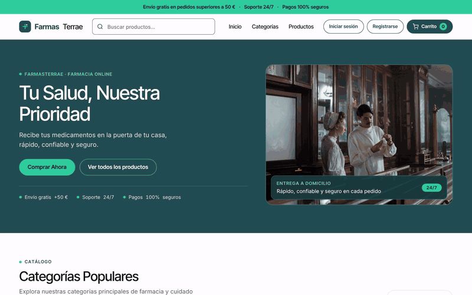
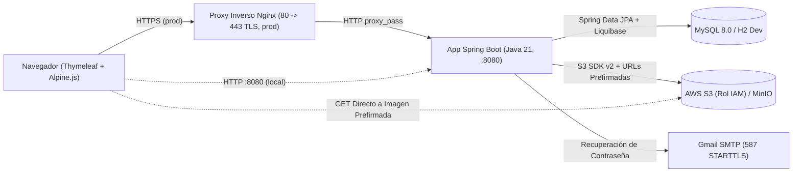

#  FarmasTerrae

Plataforma e-commerce de farmacia online renderizada en servidor, construida con Java 21, Spring Boot 3.4, Thymeleaf, Alpine.js, MySQL 8 y almacenamiento compatible con S3.

[](https://github.com/juanyaferox/FarmasTerrae/actions/workflows/maven.yml)

**Idiomas:** [English](README.md) · **Español** · [Português](README.pt.md)

**Contenido:** [Demo](#demo) · [Diseño](#aspectos-destacados-de-diseño-e-implementación) · [Funcionalidades](#funcionalidades-principales) · [Stack](#stack-tecnológico) · [Arquitectura](#arquitectura) · [Primeros Pasos](#primeros-pasos) · [Configuración](#variables-de-entorno-y-perfiles) · [Rutas](#control-de-acceso-y-rutas-principales) · [Estructura](#estructura-del-proyecto) · [Build y CI](#compilación-logs-y-ci)

> [!NOTE]
> La interfaz de la aplicación y los mensajes de validación están en español. La documentación se mantiene en inglés ([README.md](README.md)), español ([README.es.md](README.es.md)) y portugués ([README.pt.md](README.pt.md)).

---

## Demo

[](./docs/farmasterrae-demo.mp4)

<sub>Haz clic en la vista previa para abrir el vídeo en calidad completa (MP4, 27 s).</sub>

---

## Aspectos Destacados de Diseño e Implementación

- **Carga de datos con Liquibase post-Hibernate** — `LiquibaseRunnerConfig` desactiva `LiquibaseAutoConfiguration` en `prod` y `prodminio`, ejecutando `SpringLiquibase` desde un `CommandLineRunner` *después* de que Hibernate sincronice el esquema para poblar los datos desde `db/changelog/data-only-changelog.yaml`. Los datos de demostración requieren el contexto `dev` (usado por `prodminio`); `prod` solo carga los perfiles `ADMIN`/`USER`, y `AdminBootstrapRunner` crea el primer administrador a partir de las variables `ADMIN_BOOTSTRAP_*`.

- **Pipeline de imágenes en servidor y almacenamiento cloud** — `ImageCompressionService` valida subidas JPEG/PNG (firmas mágicas, dimensiones y hasta 10 MB), redimensiona proporcionalmente a un máximo de `1200×800` con interpolación bicúbica, aplana transparencias sobre fondo blanco RGB y codifica en JPEG al 85%. `S3StorageService` almacena los recursos bajo `product-images/` en AWS S3 (rol IAM de instancia en `prod`) o MinIO local y cachea URLs prefirmadas de corta duración con respaldo de marcador de posición.

- **JPA Specifications reutilizables** — `GenericSpecification` construye predicados Criteria `LIKE` insensibles a mayúsculas y comparaciones `EQUAL` validadas por tipo sobre relaciones anidadas mediante `LEFT JOIN` automático.

- **Reserva temporal de stock en checkout** — `StockReservationService` retiene las unidades del carrito durante 15 minutos (`stock.reservation.timeout.minutes`) para reducir sobreventas durante el pago y descuenta el stock real al confirmar el pedido.

- **Eliminación lógica orientada a privacidad** — `UserService` preserva la integridad histórica de los pedidos al eliminar cuentas anonimizando `username` y `email`, limpiando teléfono y dirección, registrando `deletedAt`, filtrando mediante `@SQLRestriction("deletedAt IS NULL")` e impidiendo eliminar al último administrador.

- **Auditoría global de errores correlacionados** — `GlobalExceptionHandler` combina un `Filter` de servlet con `@ControllerAdvice` para asociar cada error no controlado a un UUID `errorId` único junto con usuario, IP del cliente (`X-Forwarded-For`), URI, método HTTP y sesión.

---

## Funcionalidades Principales

- **Escaparate y Catálogo** — Portada con productos destacados aleatorios, catálogo farmacéutico organizado (medicamentos, vitaminas y suplementos, cuidado personal, primeros auxilios, belleza y cuidado de la piel, y productos para bebés), búsqueda por palabra clave, filtrado por categoría, paginación y ordenación por columnas.

- **Carrito y Checkout** — Carrito en sesión (`SessionCart`) con operaciones de añadir, incrementar, reducir, eliminar y vaciar, validación de stock en tiempo real, datos de envío precargados, múltiples métodos de pago (tarjeta de crédito, PayPal, transferencia bancaria) y seguimiento completo del estado de pedidos en las vistas de cliente y administrador.

- **Autenticación y Recuperación de Cuenta** — Acceso con Spring Security 6 mediante usuario o email, cifrado BCrypt, cookies `remember-me` de 7 días, migración ante session fixation, política de una sesión concurrente, recuperación de contraseña por Gmail SMTP y actualización autenticada con validación de complejidad.

- **Panel de Cliente (`/user/dashboard`)** — Edición de perfil, historial paginado de pedidos con detalle por artículo y reseñas verificadas limitadas a productos comprados.

- **Panel de Administración (`/admin/dashboard`)** — Gestión paginada, ordenable y filtrable de productos, pedidos y usuarios, incluyendo subida multipart de imágenes y actualización de estados.

- **Almacenamiento Agnóstico al Entorno** — Alterna entre AWS S3 (rol IAM) en producción y MinIO local sin modificar código.

---

## Stack Tecnológico

| Capa | Tecnologías |
| --- | --- |
| **Backend** | Java 21, Spring Boot 3.4.1 (Web MVC, Data JPA, Security, Validation, Mail), MapStruct 1.6.3, Lombok |
| **Frontend** | Thymeleaf, `thymeleaf-extras-springsecurity6`, Alpine.js 3, CSS modular (`tokens.css`, `components.css`, `layout.css`, `pages.css`) |
| **Base de Datos y Seed** | MySQL 8.0, Liquibase 4.32.0 (seed post-Hibernate), H2 2.3.232 (solo tests y perfil local `dev`) |
| **Almacenamiento** | AWS SDK para Java v2 (`s3`), MinIO (servidor local compatible con S3) |
| **Infraestructura y DevOps** | Dockerfile multietapa (`eclipse-temurin:21`, ejecución sin root), Docker Compose, proxy Nginx TLS, Logback, GitHub Actions |

---

## Arquitectura



---

## Primeros Pasos

**Requisitos previos:** Docker y Docker Compose (Opciones 1 y 2), o JDK 21 para ejecución directa con Maven (Opción 3; `./mvnw` está incluido).

### Opción 1 — Entorno Local Completo con Docker y MinIO (Recomendado)

Inicia **MySQL 8.0**, **Spring Boot** (perfil `prodminio`) y un servidor local **MinIO** compatible con S3 con creación automática del bucket `farmasterrae`.

1. Copia [`.env.example`](.env.example) a `.env` y rellena `DB_NAME`, `DB_USERNAME`, `DB_PASSWORD`, `MYSQL_ROOT_PASSWORD`, `MINIO_ROOT_USER` y `MINIO_ROOT_PASSWORD` (`EMAIL` y `PASSWORD` son opcionales salvo para probar correos de recuperación):

   ```bash
   cp .env.example .env
   ```

2. Construye y levanta los servicios:

   ```bash
   docker compose -f docker-compose.help.yml up --build
   ```

3. Accede a los servicios (todos los puertos se publican solo en `127.0.0.1`):
   - **Tienda** — `http://localhost:8080`
   - **Consola MinIO** — `http://localhost:9001` (`MINIO_ROOT_USER` / `MINIO_ROOT_PASSWORD`)
   - **MySQL** — `localhost:3306`

Los perfiles, usuarios, productos, pedidos y reseñas de ejemplo se cargan automáticamente mediante Liquibase con el contexto `dev` (`src/main/resources/db/changelog/data/`). Las cuentas de demostración usan la contraseña `123`, así que mantén este entorno en local. El bucket es privado: las imágenes se sirven mediante URLs prefirmadas. Las imágenes oficiales de MinIO ya no se publican, por lo que se usan las compilaciones mantenidas por la comunidad de [`pgsty/minio`](https://github.com/pgsty/minio).

### Opción 2 — Despliegue en Producción / AWS

Inicia **MySQL 8.0**, **Spring Boot** (perfil `prod`) y **Nginx** con redirección HTTP a HTTPS. Solo Nginx publica puertos (`80` y `443`); MySQL y la aplicación solo son accesibles desde la red interna de Docker.

1. Copia [`.env.example`](.env.example) a `.env` y completa todas las variables de producción (`SPRING_PROFILES_ACTIVE=prod`, `SECRET_KEY`, `DB_*`, `MYSQL_ROOT_PASSWORD`, `EMAIL`, `PASSWORD`, `AWS_REGION`, `AWS_BUCKET`), además de `ADMIN_BOOTSTRAP_USERNAME`, `ADMIN_BOOTSTRAP_EMAIL` y `ADMIN_BOOTSTRAP_PASSWORD` para el primer arranque (referencia: [`docs/env-vars-for-prod.md`](docs/env-vars-for-prod.md)).

2. Coloca el certificado TLS y la clave privada en `./ssl/` (ignorado por Git y montado en solo lectura; el repositorio no incluye ningún certificado):
   - `ssl/farmasterrae.crt`
   - `ssl/farmasterrae.key`

3. Ajusta `server_name` en [`nginx.conf`](nginx.conf) al dominio o dominios del certificado (por defecto: `localhost`). Las peticiones dirigidas a cualquier otro nombre de host se rechazan.

4. Asocia al host un rol IAM con permisos sobre el bucket S3 (`S3Config` utiliza la cadena de credenciales por defecto de AWS en `prod`, sin claves estáticas).

5. Inicia el despliegue:

   ```bash
   docker compose up --build -d
   ```

> [!IMPORTANT]
> `prod` solo carga los perfiles `ADMIN`/`USER`, nunca las cuentas de demostración. El primer administrador se crea con las variables `ADMIN_BOOTSTRAP_*` cuando todavía no existe ningún `ADMIN`; vacíalas tras el primer arranque correcto. Usa certificados emitidos por una CA (por ejemplo, Let's Encrypt) antes de publicar el servicio.

### Opción 3 — Modo Desarrollo Local con Maven y H2

Ejecuta Spring Boot directamente contra una base de datos H2 en memoria (modo compatibilidad MySQL) inicializada con `src/main/resources/data.sql`. H2 solo está en el classpath con el perfil Maven `dev`, que también activa el perfil Spring `dev`.

1. Arranca la aplicación:

   ```bash
   ./mvnw -Pdev spring-boot:run
   ```

   Los valores de desarrollo para correo y S3 ya vienen incluidos (`application-dev.properties`). Para usar valores reales, como un MinIO local, crea el archivo ignorado por Git `src/main/resources/application-secrets.properties`; sus valores tienen prioridad sobre los de desarrollo:

   ```properties
   spring.mail.username=dev@example.com
   spring.mail.password=dev-app-password
   aws.accessKey=minioadmin
   aws.secretKey=minioadmin
   aws.s3.endpoint=http://localhost:9000
   ```

2. Accesos locales:
   - **Aplicación** — `http://localhost:8080`
   - **Consola H2** — `http://localhost:8080/h2-console` (inicia sesión antes en la aplicación como `ADMIN`, p. ej. el usuario `juan` / `123` de `data.sql`)
     - JDBC URL: `jdbc:h2:mem:testdb;MODE=MySQL;DATABASE_TO_UPPER=false;DB_CLOSE_ON_EXIT=FALSE`
     - Usuario: `sa` (sin contraseña)

---

## Variables de Entorno y Perfiles

Plantilla de referencia: [`.env.example`](.env.example).

| Variable | Perfiles | Valor por defecto | Descripción |
| --- | --- | --- | --- |
| `SPRING_PROFILES_ACTIVE` | `prod` | `prod` (`Dockerfile`) | Perfil activo de Spring (`prod` en AWS; fijado a `prodminio` en `docker-compose.help.yml`). |
| `SECRET_KEY` | `prod`, `prodminio` | *(obligatoria en `prod`)* | Clave de firma para cookies `remember-me` de 7 días (`app.security`). |
| `DB_NAME` | `prod`, `prodminio` | `farmasterrae` | Nombre de la base de datos MySQL. |
| `DB_HOST` | `prod`, `prodminio` | `localhost` / `db` | Host MySQL (`localhost` en `prod`, `db` en `prodminio` / Compose). |
| `DB_PORT` | `prod`, `prodminio` | `3306` | Puerto de MySQL. |
| `DB_USERNAME` | `prod`, `prodminio` | *(obligatoria)* | Usuario de MySQL. |
| `DB_PASSWORD` | `prod`, `prodminio` | *(obligatoria)* | Contraseña de MySQL. |
| `MYSQL_ROOT_PASSWORD` | Compose | *(obligatoria)* | Contraseña de la cuenta `root` del contenedor MySQL (distinta de `DB_PASSWORD`; la aplicación nunca la usa). |
| `DB_SSL_MODE` | `prod`, `prodminio` | `PREFERRED` | `sslMode` de Connector/J (`REQUIRED`, `VERIFY_CA` o `VERIFY_IDENTITY` para bases de datos gestionadas). |
| `HIBERNATE_DDL_AUTO` | `prod` | `update` | Modo de esquema de Hibernate; cámbialo a `validate` cuando el esquema ya exista. |
| `ADMIN_BOOTSTRAP_USERNAME`, `ADMIN_BOOTSTRAP_EMAIL`, `ADMIN_BOOTSTRAP_PASSWORD` | `prod` | *(vacío)* | Crean la primera cuenta `ADMIN` al arrancar si las tres están definidas y aún no existe ningún `ADMIN`. |
| `EMAIL` | `prod`, `prodminio` | *(vacío)* | Cuenta Gmail para recuperación de contraseñas (`spring.mail.username`). |
| `PASSWORD` | `prod`, `prodminio` | *(vacío)* | **Contraseña de aplicación** de Gmail para SMTP (`spring.mail.password`). |
| `AWS_REGION` | `prod` | `us-east-1` | Región de AWS S3 (`aws.region`). |
| `AWS_BUCKET` | `prod` | `farmasterrae` | Nombre del bucket de AWS S3 (`aws.s3.bucket-name`). |
| `MINIO_ROOT_USER`, `MINIO_ROOT_PASSWORD` | `prodminio` | `minioadmin` / `minioadmin` | Credenciales root del MinIO local, que la aplicación también usa como claves S3. |
| `AWS_PUBLIC_ENDPOINT` | `prodminio` | `http://localhost:9000` | Dirección de MinIO accesible desde el navegador para las URLs prefirmadas de imágenes. |

### Perfiles Spring

| Perfil | Base de Datos | Almacenamiento | Esquema y Datos | Uso Previsto |
| --- | --- | --- | --- | --- |
| `dev` (`./mvnw -Pdev`) | H2 en memoria (modo MySQL) | Claves estáticas de desarrollo + endpoint opcional (`application-secrets.properties`) | Hibernate `update` + `data.sql` | Desarrollo Java rápido en local |
| `prodminio` | MySQL 8.0 (`db:3306`) | MinIO (`http://minio:9000`, prefirmado para `http://localhost:9000`) | Hibernate `update` + Liquibase (contexto `dev`: datos de demostración) | Pruebas full-stack locales en Docker |
| `prod` | MySQL 8.0 | AWS S3 (Rol IAM de instancia) | Hibernate (`HIBERNATE_DDL_AUTO`, por defecto `update`) + Liquibase (contexto `prod`: solo perfiles) | Producción en AWS con HTTPS |

---

## Control de Acceso y Rutas Principales

| Nivel de Acceso | Rutas | Propósito |
| --- | --- | --- |
| **Público** | `/`, `/products`, `/products/categories`, `/products/{reference}` | Escaparate, directorio de categorías, búsqueda y detalle de producto |
| **Público** | `/cart`, `/cart/add/{ref}`, `/cart/increase/{ref}`, `/cart/decrease/{ref}`, `/cart/remove/{ref}`, `/cart/clear` | Operaciones del carrito en sesión |
| **Público** | `/auth`, `/auth/register`, `/auth/forgotPassword`, `/logout` | Login, registro, recuperación de contraseña y cierre de sesión |
| **Autenticado** | `/order`, `/order/confirm`, `/auth/changePassword` | Checkout, confirmación de pedido y cambio de contraseña |
| **`USER` o `ADMIN`** | `/user/dashboard`, `/user/dashboard/info-user`, `/user/dashboard/orders`, `/user/dashboard/orders/{id}`, `/user/dashboard/reviews` | Gestión de perfil, historial de pedidos y reseñas |
| **`ADMIN`** | `/admin/dashboard`, `/admin/dashboard/products`, `/admin/dashboard/orders`, `/admin/dashboard/users` | Gestión administrativa de catálogo, pedidos y usuarios |

---

## Estructura del Proyecto

```text
FarmasTerrae/
├── .github/workflows/maven.yml          # CI con GitHub Actions (empaquetado Maven con JDK 21)
├── .dockerignore                        # Excluye secretos, certificados y artefactos de la imagen
├── .env.example                         # Plantilla de variables de entorno
├── Dockerfile                           # Imagen multietapa Temurin 21 con ejecución sin root
├── docker-compose.yml                   # Stack de producción (MySQL + App + Nginx TLS)
├── docker-compose.help.yml              # Stack local Docker (MySQL + App + MinIO)
├── docs/env-vars-for-prod.md            # Referencia de variables de entorno de producción
├── docs/mark.svg                        # Símbolo SVG de marca usado en documentación
├── frontend/                            # Herramientas opcionales Tailwind/PostCSS (ni se empaquetan ni se sirven)
├── nginx.conf                           # Proxy inverso Nginx con redirección HTTP->HTTPS
├── pom.xml                              # Dependencias Maven y procesadores MapStruct/Lombok
├── ssl/                                 # Certificado y clave TLS montados por Nginx (ignorado por Git, se aporta al desplegar)
└── src/
    ├── main/
    │   ├── java/com/iyg16260/farmasterrae/
    │   │   ├── config/                  # Security, S3, LiquibaseRunner, MVC, Web, GlobalExceptionHandler
    │   │   ├── controller/              # Controladores de tienda, Auth, Cart, Order, User y Admin
    │   │   ├── dto/                     # DTOs de Auth, Order, Payment, Product y User
    │   │   ├── enums/                   # Enumeraciones de dominio (estados de pedido, métodos de pago, operaciones)
    │   │   ├── mapper/                  # Mappers MapStruct (Product, Order, Review, User)
    │   │   ├── model/                   # Entidades JPA (User, Profile, Product, Order, OrderDetails, Review)
    │   │   ├── repository/              # Repositorios Spring Data JPA
    │   │   ├── service/                 # Lógica de negocio, StockReservation, ImageCompression, S3Storage
    │   │   ├── spec/                    # JPA Specifications dinámicas (Generic, Product, Order, User)
    │   │   └── utils/                   # SessionCart, validación de contraseñas y utilidades
    │   └── resources/
    │       ├── application*.properties  # Perfiles dev, prod y prodminio
    │       ├── data.sql                 # Datos iniciales para H2 local
    │       ├── db/changelog/            # Changelog Liquibase y scripts SQL de datos
    │       ├── logback.xml              # Appenders de consola y ficheros rotativos info/warn/error
    │       ├── static/                  # CSS modular, recursos, fuentes propias y Alpine.js fijado
    │       └── templates/               # Vistas Thymeleaf y fragmentos reutilizables
    └── test/                            # Pruebas de Spring Boot
```

---

## Compilación, Logs y CI

### Comandos Maven

```bash
# Empaquetar el JAR de producción (igual que en Dockerfile y CI; no incluye H2)
./mvnw clean package -DskipTests

# Ejecutar tests
./mvnw test

# Ejecutar en local con la base de datos H2 en memoria
./mvnw -Pdev spring-boot:run
```

### Logs

Configurados en `src/main/resources/logback.xml`:

- **Consola (`STDOUT`)** — Mensajes `INFO+` sin trazas completas.
- **Archivos rotativos** en `logs/` (ignorado por Git):
  - `logs/info.log` — rotación diaria, retención de 30 días
  - `logs/warn.log` — rotación diaria, retención de 30 días
  - `logs/error.log` — rotación diaria, retención de 90 días con stack traces completos

### Integración Continua

Cada push o pull request sobre `master` ejecuta [`.github/workflows/maven.yml`](.github/workflows/maven.yml), compilando y empaquetando el proyecto con Temurin JDK 21 y codificación UTF-8.
