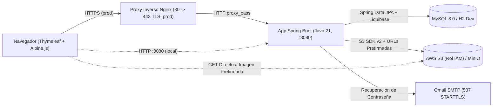

<div align="center">

# FarmasTerrae

**Plataforma e-commerce full-stack de farmacia online construida con Java 21, Spring Boot 3, Thymeleaf, Alpine.js, MySQL y almacenamiento compatible con S3.**

[](https://adoptium.net/)
[](https://spring.io/projects/spring-boot)
[](https://www.mysql.com/)
[](https://docs.docker.com/compose/)
[](https://github.com/juanyaferox/FarmasTerrae/actions/workflows/maven.yml)

**Idiomas:** [English](README.md) · **Español** · [Português](README.pt.md)

</div>

---

## Descripción General

**FarmasTerrae** es una aplicación web de comercio electrónico renderizada en servidor diseñada para una farmacia online. Incluye escaparate adaptable, catálogo por categorías, reserva temporal de stock en sesión durante la compra, panel de usuario para pedidos y reseñas, y un panel de administración completo para gestionar productos, pedidos, usuarios e imágenes.

> **Nota sobre idiomas:** La interfaz de la aplicación y los mensajes de validación están en español, mientras que la documentación del proyecto está disponible en **inglés** ([README.md](README.md)), **español** ([README.es.md](README.es.md)) y **portugués** ([README.pt.md](README.pt.md)).

## Índice

- [Aspectos Destacados de Diseño e Implementación](#aspectos-destacados-de-diseño-e-implementación)
- [Funcionalidades Principales](#funcionalidades-principales)
- [Stack Tecnológico](#stack-tecnológico)
- [Arquitectura](#arquitectura)
- [Primeros Pasos](#primeros-pasos)
  - [Opción 1: Entorno Local Completo con Docker y MinIO (Recomendado)](#opción-1-entorno-local-completo-con-docker-y-minio-recomendado)
  - [Opción 2: Despliegue en Producción / AWS](#opción-2-despliegue-en-producción--aws)
  - [Opción 3: Modo Desarrollo Local con Maven y H2](#opción-3-modo-desarrollo-local-con-maven-y-h2)
- [Variables de Entorno y Perfiles](#variables-de-entorno-y-perfiles)
- [Control de Acceso y Rutas Principales](#control-de-acceso-y-rutas-principales)
- [Estructura del Proyecto](#estructura-del-proyecto)
- [Compilación, Logs y CI](#compilación-logs-y-ci)

---

## Aspectos Destacados de Diseño e Implementación

- **Carga de datos con Liquibase post-Hibernate (`LiquibaseRunnerConfig`)**: Excluye `LiquibaseAutoConfiguration` en `prod` / `prodminio` y ejecuta `SpringLiquibase` desde un `CommandLineRunner` *después* de que Hibernate genere/actualice las tablas (`ddl-auto=update`), cargando los datos iniciales desde `db/changelog/data-only-changelog.yaml`.
- **Optimización de imágenes en servidor y almacenamiento en la nube (`ImageCompressionService`, `S3StorageService`, `ProductMapper`)**: Valida subidas (hasta 10 MB), redimensiona proporcionalmente a un máximo de `1200×800` con interpolación bicúbica, aplana transparencias sobre fondo blanco RGB, comprime en JPEG al 85%, almacena en AWS S3 (mediante rol IAM) o MinIO y resuelve automáticamente URLs prefirmadas (TTL de 2 h) en `@AfterMapping` de MapStruct.
- **Motor dinámico de consultas reutilizable (`GenericSpecification`)**: Construye predicados JPA Criteria `LIKE` insensibles a mayúsculas y comparaciones `EQUAL` validadas por tipo sobre relaciones anidadas mediante `LEFT JOIN` automático.
- **Reserva temporal de stock en checkout (`StockReservationService`)**: Retiene el inventario del carrito durante 15 minutos (`stock.reservation.timeout.minutes`) para reducir sobreventas durante el pago y descuenta el stock real al confirmar el pedido.
- **Eliminación lógica orientada a privacidad (`UserService`)**: Preserva la integridad histórica de los pedidos anonimizando datos personales (`username`/`email`, borrando teléfono/dirección), registrando `deletedAt`, filtrando con `@Where(clause = "deletedAt IS NULL")` e impidiendo borrar al último administrador.
- **Gestión global de errores con auditoría (`GlobalExceptionHandler`)**: Combina un `Filter` de servlet y `@ControllerAdvice` para asociar cada error a un UUID `errorId` junto con usuario, IP (`X-Forwarded-For`), URI, método HTTP y sesión.

---

## Funcionalidades Principales

- **Escaparate y Catálogo**
  - Página de inicio con productos destacados aleatorios y navegación rápida por categorías.
  - Catálogo farmacéutico organizado en medicamentos, vitaminas y suplementos, cuidado personal, primeros auxilios, belleza y cuidado de la piel, y productos para bebés.
  - Listado paginado con búsqueda por palabra clave, filtrado por categoría y ordenación por columnas.
- **Carrito y Checkout**
  - Carrito en sesión HTTP con soporte para añadir, incrementar, reducir, eliminar y vaciar artículos con validación de stock en tiempo real.
  - Resumen de compra con datos precargados de envío, múltiples métodos de pago (tarjeta de crédito, PayPal y transferencia bancaria) y seguimiento del ciclo de vida del pedido en las vistas de cliente y administrador.
- **Autenticación y Recuperación de Cuenta**
  - Spring Security 6 con inicio de sesión por **usuario o email**, cifrado BCrypt, cookies `remember-me` de 7 días, migración ante session fixation y política de 1 sesión concurrente.
  - Recuperación de contraseña mediante Gmail SMTP y cambio autenticado con validación de complejidad.
- **Panel de Cliente (`/user/dashboard`)**
  - Gestión de perfil, historial paginado de pedidos con detalle de artículos y reseñas verificadas limitadas a productos comprados.
- **Panel de Administración (`/admin/dashboard`)**
  - Paneles con búsqueda, ordenación y paginación para gestionar **Productos**, **Pedidos** y **Usuarios**, incluyendo subida multipart de imágenes y cambio de estado de pedidos.
- **Almacenamiento Agnóstico al Entorno**
  - Transición transparente entre **AWS S3** (rol IAM en producción) y **MinIO** (Docker local) sin cambios en el código de aplicación.

---

## Stack Tecnológico

| Capa | Tecnologías |
| --- | --- |
| **Backend** | Java 21, Spring Boot 3.4.1 (Web MVC, Data JPA, Security, Validation, Mail), MapStruct 1.6.3, Lombok |
| **Frontend** | Thymeleaf, `thymeleaf-extras-springsecurity6`, Alpine.js 3, sistema modular de CSS (`tokens.css`, `components.css`, `layout.css`, `pages.css`) |
| **Base de Datos y Seed** | MySQL 8.0, Liquibase 4.32.0 (carga de datos post-Hibernate), H2 2.3.232 (perfil `dev` local) |
| **Almacenamiento** | AWS SDK para Java v2 (`s3`), MinIO (servidor local compatible con S3) |
| **Infraestructura y DevOps** | Dockerfile multietapa (`eclipse-temurin:21`), Docker Compose, proxy inverso Nginx (TLS 1.2/1.3), logs rotativos Logback, GitHub Actions |

---

## Arquitectura



---

## Primeros Pasos

### Requisitos Previos

- **Docker y Docker Compose** (para la Opción 1 y la Opción 2)
- **JDK 21** (solo para la Opción 3; Maven está incluido con `./mvnw`)

---

### Opción 1: Entorno Local Completo con Docker y MinIO (Recomendado)

Levanta **MySQL 8.0**, **Spring Boot** (perfil `prodminio`) y un servidor local **MinIO** compatible con S3 creando automáticamente el bucket `farmasterrae`.

1. **Crea el archivo `.env` a partir de [`.env.example`](.env.example):**

   ```bash
   cp .env.example .env
   ```

   Para el modo local con MinIO, las variables necesarias en `.env` son `DB_NAME`, `DB_USERNAME` y `DB_PASSWORD`. `EMAIL` y `PASSWORD` son opcionales (solo se requieren para probar los correos de recuperación).

2. **Construye e inicia los contenedores:**

   ```bash
   docker compose -f docker-compose.help.yml up --build
   ```

3. **Accede a los servicios:**
   - **Tienda**: `http://localhost:8080`
   - **Consola MinIO**: `http://localhost:9001` (`minioadmin` / `minioadmin`)
   - **MySQL**: `localhost:3306`

> Los perfiles, usuarios, productos, pedidos y reseñas de ejemplo se cargan automáticamente con Liquibase (`src/main/resources/db/changelog/data/`).

---

### Opción 2: Despliegue en Producción / AWS

Levanta **MySQL 8.0**, **Spring Boot** (perfil `prod`) y **Nginx** con redirección HTTP→HTTPS (puertos `80` y `443`).

1. **Configura `.env` desde [`.env.example`](.env.example):**

   ```bash
   cp .env.example .env
   ```

   Rellena todas las variables (`SPRING_PROFILES_ACTIVE=prod`, `SECRET_KEY`, `DB_*`, `EMAIL`, `PASSWORD`, `AWS_REGION`, `AWS_BUCKET`).

2. **Añade los certificados TLS** en `./ssl/`:
   - `ssl/farmasterrae.crt`
   - `ssl/farmasterrae.key`

   > Sustituye cualquier certificado autofirmado de desarrollo por certificados emitidos por una CA válida (por ejemplo, Let's Encrypt) antes de publicar en producción.

3. **Permisos de AWS S3**: En `prod`, `S3Config` utiliza `DefaultCredentialsProvider` (rol IAM de instancia EC2/ECS) sin necesidad de claves estáticas.

4. **Inicia el despliegue:**

   ```bash
   docker compose up --build -d
   ```

---

### Opción 3: Modo Desarrollo Local con Maven y H2

Ejecuta Spring Boot directamente con una base de datos H2 en memoria (en modo compatibilidad MySQL) cargada con `src/main/resources/data.sql`.

1. **Crea el archivo ignorado por Git** `src/main/resources/application-secrets.properties` para resolver las propiedades de correo y S3 al arrancar:

   ```properties
   spring.mail.username=dev@example.com
   spring.mail.password=dev-app-password
   aws.accessKey=minioadmin
   aws.secretKey=minioadmin
   aws.region=us-east-1
   aws.s3.bucket-name=farmasterrae
   aws.s3.endpoint=http://localhost:9000
   ```

2. **Arranca la aplicación:**

   ```bash
   ./mvnw spring-boot:run
   ```

3. **Accesos locales:**
   - **Aplicación**: `http://localhost:8080`
   - **Consola H2**: `http://localhost:8080/h2-console`
     - JDBC URL: `jdbc:h2:mem:testdb;MODE=MySQL;DATABASE_TO_UPPER=false;DB_CLOSE_ON_EXIT=FALSE`
     - Usuario: `sa` (sin contraseña)

---

## Variables de Entorno y Perfiles

Consulta [`.env.example`](.env.example) para copiar una plantilla lista para usar.

| Variable | Perfiles | Valor por defecto | Descripción |
| --- | --- | --- | --- |
| `SPRING_PROFILES_ACTIVE` | `prod` | `prod` (en `Dockerfile`) | Perfil activo de Spring (`prod` en AWS; fijado a `prodminio` en `docker-compose.help.yml`). |
| `SECRET_KEY` | `prod`, `prodminio` | `uniqueAndSecret` | Clave de firma para las cookies `remember-me` de 7 días (`app.security`). |
| `DB_NAME` | `prod`, `prodminio` | `farmasterrae` | Nombre de la base de datos MySQL. |
| `DB_HOST` | `prod`, `prodminio` | `localhost` (`prod`) / `db` (`prodminio`) | Host de MySQL (`db` dentro de Docker Compose). |
| `DB_PORT` | `prod`, `prodminio` | `3306` | Puerto de MySQL. |
| `DB_USERNAME` | `prod`, `prodminio` | `root` | Usuario de MySQL. |
| `DB_PASSWORD` | `prod`, `prodminio` | *(vacío)* | Contraseña de MySQL (también usada como `MYSQL_ROOT_PASSWORD` en Compose). |
| `EMAIL` | `prod`, `prodminio` | *(vacío)* | Cuenta de Gmail para recuperación de contraseñas (`spring.mail.username`). |
| `PASSWORD` | `prod`, `prodminio` | *(vacío)* | **Contraseña de aplicación** de Gmail para SMTP (`spring.mail.password`). |
| `AWS_REGION` | `prod` | `us-east-1` | Región de AWS S3 (`aws.region`). |
| `AWS_BUCKET` | `prod` | `farmasterrae` | Nombre del bucket de AWS S3 (`aws.s3.bucket-name`). |

### Resumen de Perfiles Spring

| Perfil | Base de Datos | Almacenamiento | Esquema / Datos | Uso Previsto |
| --- | --- | --- | --- | --- |
| *(defecto / `dev`)* | H2 en memoria (modo MySQL) | Claves estáticas + endpoint opcional (`application-secrets.properties`) | Hibernate `update` + `data.sql` | Desarrollo Java rápido en local |
| `prodminio` | MySQL 8.0 (`db:3306`) | MinIO (`http://minio:9000` → `http://localhost:9000`) | Hibernate `update` + Liquibase | Pruebas full-stack locales en Docker |
| `prod` | MySQL 8.0 | AWS S3 (Rol IAM de instancia) | Hibernate `update` + Liquibase | Producción en AWS con HTTPS |

---

## Control de Acceso y Rutas Principales

| Nivel de Acceso | Rutas | Propósito |
| --- | --- | --- |
| **Público** | `/`, `/products`, `/products/categories`, `/products/{reference}` | Escaparate, directorio de categorías, búsqueda y detalle de producto |
| **Público** | `/cart`, `/cart/add/{ref}`, `/cart/increase/{ref}`, `/cart/decrease/{ref}`, `/cart/remove/{ref}`, `/cart/clear` | Gestión del carrito en sesión |
| **Público** | `/auth`, `/auth/register`, `/auth/forgotPassword`, `/logout` | Login, registro, recuperación de contraseña y cierre de sesión |
| **Autenticado** | `/order`, `/order/confirm`, `/auth/changePassword` | Checkout, confirmación de pedido y cambio de contraseña |
| **`USER` o `ADMIN`** | `/user/dashboard`, `/user/dashboard/info-user`, `/user/dashboard/orders`, `/user/dashboard/orders/{id}`, `/user/dashboard/reviews` | Gestión de perfil, historial de pedidos y reseñas |
| **`ADMIN`** | `/admin/dashboard`, `/admin/dashboard/products`, `/admin/dashboard/orders`, `/admin/dashboard/users` | Panel de administración de catálogo, pedidos y usuarios |

---

## Estructura del Proyecto

```text
FarmasTerrae/
├── .github/workflows/maven.yml          # CI con GitHub Actions (empaquetado Maven con JDK 21)
├── .env.example                         # Plantilla de variables de entorno
├── Dockerfile                           # Imagen multietapa de compilación y ejecución Temurin 21
├── docker-compose.yml                   # Stack de producción (MySQL + App + Nginx TLS)
├── docker-compose.help.yml              # Stack local Docker (MySQL + App + MinIO)
├── nginx.conf                           # Proxy inverso Nginx con redirección HTTP->HTTPS
├── pom.xml                              # Dependencias Maven y procesadores MapStruct/Lombok
├── ssl/                                 # Certificado y clave TLS montados por Nginx
└── src/
    ├── main/
    │   ├── java/com/iyg16260/farmasterrae/
    │   │   ├── config/                  # Security, S3, LiquibaseRunner, MVC, Web, GlobalExceptionHandler
    │   │   ├── controller/              # Controladores de tienda, Auth, Cart, Order, User y Admin
    │   │   ├── dto/                     # DTOs de Auth, Order, Payment, Product y User
    │   │   ├── enums/                   # Enumeraciones de dominio (estados de pedido, métodos de pago, operaciones)
    │   │   ├── mapper/                  # Mappers MapStruct (Product, Order, Review, User)
    │   │   ├── model/                   # Entidades JPA (User, Profile, Product, Order, OrderDetails, Review)
    │   │   ├── repository/              # Repositorios Spring Data JPA
    │   │   ├── service/                 # Lógica de negocio, StockReservation, ImageCompression, S3Storage
    │   │   ├── spec/                    # JPA Specifications dinámicas (Generic, Product, Order, User)
    │   │   └── utils/                   # SessionCart, validación de contraseñas y utilidades
    │   └── resources/
    │       ├── application*.properties  # Perfiles dev, prod y prodminio
    │       ├── data.sql                 # Datos iniciales para H2 local
    │       ├── db/changelog/            # Changelog Liquibase y scripts SQL de datos
    │       ├── logback.xml              # Appenders de consola y ficheros rotativos info/warn/error
    │       ├── static/                  # CSS modular (tokens/components/layout/pages) y recursos
    │       └── templates/               # Vistas Thymeleaf y fragmentos reutilizables
    └── test/                            # Pruebas de Spring Boot
```

---

## Compilación, Logs y CI

### Comandos Maven

```bash
# Empaquetar el JAR (igual que en Dockerfile y CI)
./mvnw clean package -DskipTests

# Ejecutar tests
./mvnw test
```

### Logs

Configurados en `src/main/resources/logback.xml`:

- **Consola (`STDOUT`)**: Mensajes `INFO+` sin trazas completas.
- **Archivos rotativos** en `logs/` (ignorado por Git):
  - `logs/info.log` — rotación diaria, retención de 30 días
  - `logs/warn.log` — rotación diaria, retención de 30 días
  - `logs/error.log` — rotación diaria, retención de 90 días con stack traces completos

### Integración Continua

Cada push o pull request sobre `master` ejecuta [`.github/workflows/maven.yml`](.github/workflows/maven.yml), compilando y empaquetando el proyecto con Temurin JDK 21 y codificación UTF-8.
