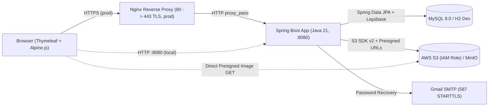

#  FarmasTerrae

Server-rendered online pharmacy e-commerce platform built with Java 21, Spring Boot 3.4, Thymeleaf, Alpine.js, MySQL 8, and S3-compatible object storage.

[](https://github.com/juanyaferox/FarmasTerrae/actions/workflows/maven.yml)

**Languages:** **English** · [Español](README.es.md) · [Português](README.pt.md)
<br />
**Contents:** [Highlights](#design--implementation-highlights) · [Features](#key-features) · [Stack](#tech-stack) · [Architecture](#architecture) · [Getting Started](#getting-started) · [Configuration](#environment-variables--profiles) · [Routes](#access-control--main-routes) · [Structure](#project-structure) · [Build & CI](#build-logging--ci)

> [!NOTE]
> The application UI and validation messages are currently in Spanish, while repository documentation is maintained in English ([README.md](README.md)), Spanish ([README.es.md](README.es.md)), and Portuguese ([README.pt.md](README.pt.md)).

---

## Design & Implementation Highlights

- **Post-Hibernate Liquibase Data Seeding** — `LiquibaseRunnerConfig` excludes default `LiquibaseAutoConfiguration` in `prod` and `prodminio`, triggering `SpringLiquibase` from a `CommandLineRunner` *after* Hibernate completes schema synchronization (`ddl-auto=update`) to seed datasets from `db/changelog/data-only-changelog.yaml`.
- **Server-Side Image Optimization & Cloud Media Pipeline** — `ImageCompressionService` validates uploads (up to 10 MB), downscales proportionally to at most `1200×800` via bicubic interpolation, flattens alpha channels onto white RGB, and encodes 85% JPEG. `S3StorageService` stores assets in AWS S3 (IAM instance role in `prod`) or MinIO (local Docker), and `ProductMapper` resolves 2-hour presigned URLs automatically in `@AfterMapping` hooks.
- **Composable JPA Specifications** — `GenericSpecification` constructs multi-field case-insensitive `LIKE` and type-validated `EQUAL` Criteria predicates across nested entity paths using automatic `LEFT JOIN` traversal.
- **Temporary Checkout Stock Reservations** — `StockReservationService` holds session cart quantities for 15 minutes (`stock.reservation.timeout.minutes`) to reduce overselling during checkout and commits real inventory deductions on order confirmation.
- **Privacy-Aware Soft Deletion** — `UserService` preserves historical order integrity on account removal by anonymizing PII (`username` and `email`, clearing phone and address), recording `deletedAt`, filtering transparently via `@Where(clause = "deletedAt IS NULL")`, and blocking deletion of the final administrator.
- **Correlated Global Error Auditing** — `GlobalExceptionHandler` pairs a servlet `Filter` with `@ControllerAdvice` to tag unhandled errors with a unique UUID `errorId` alongside user identity, client IP (`X-Forwarded-For`), request URI, HTTP method, and session metadata.

---

## Key Features

- **Storefront & Catalog** — Home page with randomized featured products, curated pharmacy categories (medicines, vitamins & supplements, personal care, first aid, skincare & beauty, and baby care), keyword search, category filtering, pagination, and multi-column sorting.
- **Shopping Cart & Checkout** — Session-backed cart (`SessionCart`) with add, increment, decrement, remove, and clear operations, live stock validation, prefilled shipping details, multiple payment options (credit card, PayPal, bank transfer), and end-to-end order status tracking across customer and admin views.
- **Authentication & Account Recovery** — Spring Security 6 authentication supporting login by username or email, BCrypt password hashing, 7-day `remember-me` cookies, session fixation migration, single concurrent session enforcement, Gmail SMTP password recovery, and authenticated password updates with complexity checks.
- **Customer Dashboard (`/user/dashboard`)** — Profile editing, paginated order history with line-item details, and verified product reviews limited to purchased items.
- **Admin Dashboard (`/admin/dashboard`)** — Searchable, sortable, paginated management for products, orders, and users, including multipart image uploads and order status updates.
- **Environment-Agnostic Storage** — Switches cleanly between AWS S3 (IAM instance role) in production and MinIO in local Docker with no code changes.

---

## Tech Stack

| Layer | Technologies |
| --- | --- |
| **Backend** | Java 21, Spring Boot 3.4.1 (Web MVC, Data JPA, Security, Validation, Mail), MapStruct 1.6.3, Lombok |
| **Frontend** | Thymeleaf, `thymeleaf-extras-springsecurity6`, Alpine.js 3, modular CSS design system (`tokens.css`, `components.css`, `layout.css`, `pages.css`) |
| **Database & Seeding** | MySQL 8.0, Liquibase 4.32.0 (post-Hibernate data seeding), H2 2.3.232 (local `dev` profile) |
| **Object Storage** | AWS SDK for Java v2 (`s3`), MinIO (local S3-compatible server) |
| **Infrastructure & DevOps** | Multi-stage Dockerfile (`eclipse-temurin:21`), Docker Compose, Nginx reverse proxy (TLS 1.2/1.3), Logback rolling logs, GitHub Actions |

---

## Architecture



---

## Getting Started

**Prerequisites:** Docker & Docker Compose (Options 1 and 2), or JDK 21 for direct Maven execution (Option 3; `./mvnw` is bundled).

### Option 1 — Local Full Stack with Docker & MinIO (Recommended)

Starts **MySQL 8.0**, **Spring Boot** (`prodminio` profile), and a local **MinIO** S3-compatible server with automatic bucket initialization (`farmasterrae`).

1. Copy [`.env.example`](.env.example) to `.env` and fill in `DB_NAME`, `DB_USERNAME`, and `DB_PASSWORD` (`EMAIL` and `PASSWORD` are optional unless testing password recovery emails):

   ```bash
   cp .env.example .env
   ```

2. Build and start the stack:

   ```bash
   docker compose -f docker-compose.help.yml up --build
   ```

3. Open the running services:
   - Storefront — `http://localhost:8080`
   - MinIO Console — `http://localhost:9001` (`minioadmin` / `minioadmin`)
   - MySQL — `localhost:3306`

Sample profiles, users, products, orders, and reviews are seeded automatically via Liquibase (`src/main/resources/db/changelog/data/`).

### Option 2 — Production / AWS Deployment

Starts **MySQL 8.0**, **Spring Boot** (`prod` profile), and **Nginx** with HTTP-to-HTTPS redirection (ports `80` and `443`).

1. Copy [`.env.example`](.env.example) to `.env` and populate all production variables (`SPRING_PROFILES_ACTIVE=prod`, `SECRET_KEY`, `DB_*`, `EMAIL`, `PASSWORD`, `AWS_REGION`, `AWS_BUCKET`).
2. Place your TLS certificate and private key in `./ssl/`:
   - `ssl/farmasterrae.crt`
   - `ssl/farmasterrae.key`
3. Attach an IAM role with S3 bucket access to the host (`S3Config` resolves credentials via `DefaultCredentialsProvider` in `prod`, requiring no static AWS keys).
4. Launch the stack:

   ```bash
   docker compose up --build -d
   ```

> [!IMPORTANT]
> Replace any development or self-signed certificates in `./ssl/` with valid CA-issued certificates (such as Let's Encrypt) before exposing the application publicly.

### Option 3 — Local Maven Dev Mode (H2 In-Memory)

Runs Spring Boot directly against an in-memory H2 database (MySQL compatibility mode) seeded from `src/main/resources/data.sql`.

1. Create the gitignored file `src/main/resources/application-secrets.properties` to satisfy mail and S3 property placeholders on startup:

   ```properties
   spring.mail.username=dev@example.com
   spring.mail.password=dev-app-password
   aws.accessKey=minioadmin
   aws.secretKey=minioadmin
   aws.region=us-east-1
   aws.s3.bucket-name=farmasterrae
   aws.s3.endpoint=http://localhost:9000
   ```

2. Start the application:

   ```bash
   ./mvnw spring-boot:run
   ```

3. Open the local endpoints:
   - Application — `http://localhost:8080`
   - H2 Console — `http://localhost:8080/h2-console`
     - JDBC URL: `jdbc:h2:mem:testdb;MODE=MySQL;DATABASE_TO_UPPER=false;DB_CLOSE_ON_EXIT=FALSE`
     - Username: `sa` (empty password)

---

## Environment Variables & Profiles

Reference template: [`.env.example`](.env.example).

| Variable | Profiles | Default | Description |
| --- | --- | --- | --- |
| `SPRING_PROFILES_ACTIVE` | `prod` | `prod` (`Dockerfile`) | Active Spring profile (`prod` for AWS; fixed to `prodminio` in `docker-compose.help.yml`). |
| `SECRET_KEY` | `prod`, `prodminio` | `uniqueAndSecret` | Signing key for 7-day `remember-me` cookies (`app.security`). |
| `DB_NAME` | `prod`, `prodminio` | `farmasterrae` | MySQL database name (also sets `spring.application.name`). |
| `DB_HOST` | `prod`, `prodminio` | `localhost` (`prod`) / `db` (`prodminio`) | MySQL host (`db` inside Docker Compose). |
| `DB_PORT` | `prod`, `prodminio` | `3306` | MySQL port. |
| `DB_USERNAME` | `prod`, `prodminio` | `root` | MySQL username. |
| `DB_PASSWORD` | `prod`, `prodminio` | *(empty)* | MySQL password (also used as `MYSQL_ROOT_PASSWORD` in Compose). |
| `EMAIL` | `prod`, `prodminio` | *(empty)* | Gmail address for SMTP password recovery (`spring.mail.username`). |
| `PASSWORD` | `prod`, `prodminio` | *(empty)* | Gmail **App Password** for SMTP authentication (`spring.mail.password`). |
| `AWS_REGION` | `prod` | `us-east-1` | AWS S3 region (`aws.region`). |
| `AWS_BUCKET` | `prod` | `farmasterrae` | AWS S3 bucket name (`aws.s3.bucket-name`). |

### Spring Profiles

| Profile | Database | Object Storage | Schema & Seed | Intended Use |
| --- | --- | --- | --- | --- |
| *(default / `dev`)* | H2 in-memory (MySQL mode) | Static keys + optional endpoint (`application-secrets.properties`) | Hibernate `update` + `data.sql` | Fast local Java development |
| `prodminio` | MySQL 8.0 (`db:3306`) | MinIO (`http://minio:9000` → `http://localhost:9000`) | Hibernate `update` + Liquibase | Local Docker full-stack testing |
| `prod` | MySQL 8.0 | AWS S3 (IAM Instance Role) | Hibernate `update` + Liquibase | AWS / HTTPS production deployment |

---

## Access Control & Main Routes

| Access Level | Routes | Purpose |
| --- | --- | --- |
| **Public** | `/`, `/products`, `/products/categories`, `/products/{reference}` | Storefront, category directory, catalog search, and product details |
| **Public** | `/cart`, `/cart/add/{ref}`, `/cart/increase/{ref}`, `/cart/decrease/{ref}`, `/cart/remove/{ref}`, `/cart/clear` | Session shopping cart operations |
| **Public** | `/auth`, `/auth/register`, `/auth/forgotPassword`, `/logout` | Login, registration, password recovery, and logout |
| **Authenticated** | `/order`, `/order/confirm`, `/auth/changePassword` | Checkout, order confirmation, and password update |
| **`USER` or `ADMIN`** | `/user/dashboard`, `/user/dashboard/info-user`, `/user/dashboard/orders`, `/user/dashboard/orders/{id}`, `/user/dashboard/reviews` | Profile management, personal order history, and product reviews |
| **`ADMIN` only** | `/admin/dashboard`, `/admin/dashboard/products`, `/admin/dashboard/orders`, `/admin/dashboard/users` | Back-office management of catalog, orders, and user accounts |

---

## Project Structure

```text
FarmasTerrae/
├── .github/workflows/maven.yml          # GitHub Actions CI (JDK 21 Maven package)
├── .env.example                         # Environment variable template
├── Dockerfile                           # Multi-stage Temurin 21 build & runtime image
├── docker-compose.yml                   # Production stack (MySQL + App + Nginx TLS)
├── docker-compose.help.yml              # Local Docker stack (MySQL + App + MinIO)
├── docs/mark.svg                        # Brand mark SVG used in documentation
├── nginx.conf                           # Nginx HTTP->HTTPS reverse proxy configuration
├── pom.xml                              # Maven dependencies & MapStruct/Lombok compiler config
├── ssl/                                 # TLS certificate & key mounted by Nginx
└── src/
    ├── main/
    │   ├── java/com/iyg16260/farmasterrae/
    │   │   ├── config/                  # Security, S3, LiquibaseRunner, MVC, Web, GlobalExceptionHandler
    │   │   ├── controller/              # Storefront, Auth, Cart, Order, User, and Admin controllers
    │   │   ├── dto/                     # Auth, Order, Payment, Product, and User DTOs
    │   │   ├── enums/                   # Domain enumerations (order statuses, payment methods, operations)
    │   │   ├── mapper/                  # MapStruct mappers (Product, Order, Review, User)
    │   │   ├── model/                   # JPA entities (User, Profile, Product, Order, OrderDetails, Review)
    │   │   ├── repository/              # Spring Data JPA repositories
    │   │   ├── service/                 # Business logic, StockReservation, ImageCompression, S3Storage
    │   │   ├── spec/                    # Dynamic JPA Specifications (Generic, Product, Order, User)
    │   │   └── utils/                   # SessionCart, password validation, message/price helpers
    │   └── resources/
    │       ├── application*.properties  # dev, prod, and prodminio Spring profiles
    │       ├── data.sql                 # H2 local dev seed data
    │       ├── db/changelog/            # Liquibase data-only changelog & SQL seed files
    │       ├── logback.xml              # Console + rolling info/warn/error file appenders
    │       ├── static/                  # Modular CSS (tokens/components/layout/pages) & assets
    │       └── templates/               # Thymeleaf views & reusable fragments
    └── test/                            # Spring Boot test suite
```

---

## Build, Logging & CI

### Maven Commands

```bash
# Package JAR (matches Dockerfile and CI)
./mvnw clean package -DskipTests

# Run test suite
./mvnw test
```

### Logging

Configured in `src/main/resources/logback.xml`:

- **Console (`STDOUT`)** — Formatted `INFO+` entries without full stack traces.
- **Rolling log files** under `logs/` (gitignored):
  - `logs/info.log` — daily rotation, 30-day retention
  - `logs/warn.log` — daily rotation, 30-day retention
  - `logs/error.log` — daily rotation, 90-day retention, full stack traces

### Continuous Integration

Every push and pull request targeting `master` runs [`.github/workflows/maven.yml`](.github/workflows/maven.yml), compiling and packaging the artifact with Temurin JDK 21 and UTF-8 encoding.
