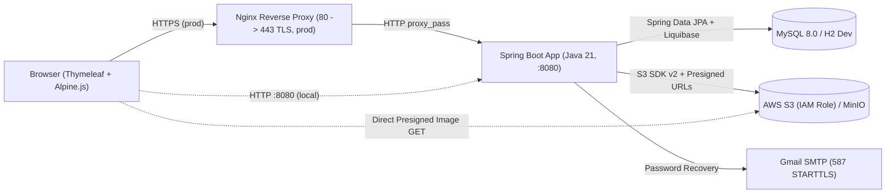

<div align="center">

# FarmasTerrae

**Full-stack online pharmacy e-commerce platform built with Java 21, Spring Boot 3, Thymeleaf, Alpine.js, MySQL, and S3-compatible object storage.**

[](https://adoptium.net/)
[](https://spring.io/projects/spring-boot)
[](https://www.mysql.com/)
[](https://docs.docker.com/compose/)
[](https://github.com/juanyaferox/FarmasTerrae/actions/workflows/maven.yml)

**Languages:** **English** · [Español](README.es.md) · [Português](README.pt.md)

</div>

---

## Overview

**FarmasTerrae** is a server-rendered e-commerce web application designed for an online pharmacy. It provides a responsive storefront, category-based catalog browsing, temporary session-backed stock reservations during checkout, customer order/review management, and a full administrative back office for managing products, orders, users, and media uploads.

> **Note on localization:** The application UI and validation messages are currently in Spanish, while project documentation is available in **English** ([README.md](README.md)), **Spanish** ([README.es.md](README.es.md)), and **Portuguese** ([README.pt.md](README.pt.md)).

## Table of Contents

- [Key Features](#key-features)
- [Tech Stack](#tech-stack)
- [Architecture](#architecture)
- [Design & Implementation Highlights](#design--implementation-highlights)
- [Getting Started](#getting-started)
  - [Option 1: Local Full Stack with Docker & MinIO (Recommended)](#option-1-local-full-stack-with-docker--minio-recommended)
  - [Option 2: Production / AWS Deployment](#option-2-production--aws-deployment)
  - [Option 3: Local Maven Dev Mode (H2 In-Memory)](#option-3-local-maven-dev-mode-h2-in-memory)
- [Environment Variables & Profiles](#environment-variables--profiles)
- [Access Control & Main Routes](#access-control--main-routes)
- [Project Structure](#project-structure)
- [Build, Logging & CI](#build-logging--ci)

---

## Key Features

- **Storefront & Catalog**
  - Home page featuring randomized highlighted products and category shortcuts.
  - Six pharmacy categories: `MEDICINE`, `VITAMIN`, `CARE`, `FIRST_AID`, `BEAUTY`, and `BABY`.
  - Paginated product listings with dynamic keyword search, category filtering, and sorting built on JPA Specifications.
- **Shopping Cart & Stock Reservation**
  - HTTP session cart (`SessionCart`) supporting add, increment, decrement, remove, and clear actions.
  - Temporary stock reservation service (`StockReservationService`) holding cart inventory for 15 minutes (`stock.reservation.timeout.minutes`) and deducting real stock upon checkout confirmation.
- **Checkout & Order Lifecycle**
  - Order summary with prefilled shipping details and selectable payment methods (`CREDIT_CARD`, `PAYPAL`, `TRANSFER`).
  - Order statuses (`PENDING`, `SHIPPED`, `COMPLETED`, `CANCELLED`) tracked across customer and admin views.
- **Authentication & Account Recovery**
  - Spring Security 6 form authentication supporting login by **username or email**, BCrypt password hashing, 7-day `remember-me` cookies, session fixation migration, and a single concurrent session policy.
  - Password recovery via Gmail SMTP and authenticated password changes with complexity validation.
- **Customer Dashboard (`/user/dashboard`)**
  - Profile editing, paginated order history with line-item order details, and product reviews restricted to items the user has purchased.
- **Admin Dashboard (`/admin/dashboard`)**
  - Searchable, sortable, paginated CRUD for **Products**, **Orders**, and **Users**.
  - Multipart product image uploads with automatic server-side resizing and JPEG compression.
  - GDPR-style user deletion via PII anonymization (`deleted_<id>`) with protection against removing the last administrator.
- **Cloud-Native Media Pipeline**
  - Works seamlessly with **AWS S3** (production, via IAM instance roles) and **MinIO** (local Docker development), serving product images via time-limited presigned URLs (2-hour TTL).

---

## Tech Stack

| Layer | Technologies |
| --- | --- |
| **Backend** | Java 21, Spring Boot 3.4.1 (Web MVC, Data JPA, Security, Validation, Mail), MapStruct 1.6.3, Lombok |
| **Frontend** | Thymeleaf, `thymeleaf-extras-springsecurity6`, Alpine.js 3, modular CSS design system (`tokens.css`, `components.css`, `layout.css`, `pages.css`) |
| **Database & Seeding** | MySQL 8.0, Liquibase 4.32.0 (post-Hibernate data seeding), H2 2.3.232 (local `dev` profile) |
| **Object Storage** | AWS SDK for Java v2 (`s3`), MinIO (local S3-compatible server) |
| **Infrastructure & DevOps** | Multi-stage Dockerfile (`eclipse-temurin:21`), Docker Compose, Nginx reverse proxy (TLS 1.2/1.3), Logback rolling logs, GitHub Actions |

---

## Architecture



---

## Design & Implementation Highlights

- **Post-Hibernate Liquibase Data Seeding (`LiquibaseRunnerConfig`)**: Standard `LiquibaseAutoConfiguration` is excluded in `prod` / `prodminio`; instead, a `CommandLineRunner` triggers `SpringLiquibase` *after* Hibernate creates/updates the schema (`ddl-auto=update`), cleanly seeding profiles, users, products, orders, order details, and reviews from `db/changelog/data-only-changelog.yaml`.
- **Automatic Image Pipeline (`ImageCompressionService` + `S3StorageService` + `ProductMapper`)**: Uploaded images (up to 10 MB) are downscaled proportionally to at most `1200×800` using bicubic interpolation, flattened onto a white RGB background, compressed to 85% JPEG, stored in S3/MinIO, and automatically resolved to 2-hour presigned URLs in MapStruct `@AfterMapping` hooks.
- **Reusable Dynamic Filtering (`GenericSpecification`)**: Supports multi-field case-insensitive `LIKE` and type-validated `EQUAL` predicates across nested entity paths using automatic `LEFT JOIN` traversal.
- **Soft-Delete User Anonymization (`UserService`)**: Rather than breaking historical order integrity, deleting a user anonymizes `username`/`email`, clears phone/address, timestamps `deletedAt`, and filters records transparently with `@Where(clause = "deletedAt IS NULL")`.
- **Audited Error Handling (`GlobalExceptionHandler`)**: Combines a servlet `Filter` and `@ControllerAdvice` to attach a unique UUID `errorId` plus user, client IP (`X-Forwarded-For`), URI, method, and session metadata to error logs.

---

## Getting Started

### Prerequisites

- **Docker & Docker Compose** (for Option 1 and Option 2)
- **JDK 21** (only needed for Option 3; Maven is bundled via `./mvnw`)

---

### Option 1: Local Full Stack with Docker & MinIO (Recommended)

Runs **MySQL 8.0**, **Spring Boot** (`prodminio` profile), and a local **MinIO** S3-compatible server with automatic bucket creation (`farmasterrae`).

1. **Create your `.env` file from [`.env.example`](.env.example):**

   ```bash
   cp .env.example .env
   ```

   For local MinIO mode, the required variables in `.env` are `DB_NAME`, `DB_USERNAME`, and `DB_PASSWORD`. `EMAIL` and `PASSWORD` are optional (only needed to test password recovery emails).

2. **Build and start the stack:**

   ```bash
   docker compose -f docker-compose.help.yml up --build
   ```

3. **Access the services:**
   - **Storefront**: `http://localhost:8080`
   - **MinIO Console**: `http://localhost:9001` (`minioadmin` / `minioadmin`)
   - **MySQL**: `localhost:3306`

> Sample profiles, users, products, orders, and reviews are seeded automatically via Liquibase (`src/main/resources/db/changelog/data/`).

---

### Option 2: Production / AWS Deployment

Runs **MySQL 8.0**, **Spring Boot** (`prod` profile), and **Nginx** with HTTP→HTTPS redirection (ports `80` and `443`).

1. **Configure `.env` from [`.env.example`](.env.example):**

   ```bash
   cp .env.example .env
   ```

   Populate all variables (`SPRING_PROFILES_ACTIVE=prod`, `SECRET_KEY`, `DB_*`, `EMAIL`, `PASSWORD`, `AWS_REGION`, `AWS_BUCKET`).

2. **Provide TLS certificates** in `./ssl/`:
   - `ssl/farmasterrae.crt`
   - `ssl/farmasterrae.key`

   > Replace any development/self-signed certificates with valid CA-issued certificates (e.g. Let's Encrypt) before deploying publicly.

3. **Ensure AWS S3 permissions**: In `prod`, `S3Config` uses `DefaultCredentialsProvider` (EC2/ECS IAM instance role) rather than static access keys.

4. **Start the production stack:**

   ```bash
   docker compose up --build -d
   ```

---

### Option 3: Local Maven Dev Mode (H2 In-Memory)

Runs Spring Boot directly with an in-memory H2 database (MySQL compatibility mode) seeded from `src/main/resources/data.sql`.

1. **Create the gitignored secrets file** `src/main/resources/application-secrets.properties` so Spring can resolve the mail and S3 property placeholders on startup:

   ```properties
   spring.mail.username=dev@example.com
   spring.mail.password=dev-app-password
   aws.accessKey=minioadmin
   aws.secretKey=minioadmin
   aws.region=us-east-1
   aws.s3.bucket-name=farmasterrae
   aws.s3.endpoint=http://localhost:9000
   ```

2. **Run the application:**

   ```bash
   ./mvnw spring-boot:run
   ```

3. **Access local tools:**
   - **Application**: `http://localhost:8080`
   - **H2 Console**: `http://localhost:8080/h2-console`
     - JDBC URL: `jdbc:h2:mem:testdb;MODE=MySQL;DATABASE_TO_UPPER=false;DB_CLOSE_ON_EXIT=FALSE`
     - User: `sa` (empty password)

---

## Environment Variables & Profiles

See [`.env.example`](.env.example) for a ready-to-copy template.

| Variable | Profiles | Default | Description |
| --- | --- | --- | --- |
| `SPRING_PROFILES_ACTIVE` | `prod` | `prod` (in `Dockerfile`) | Active Spring profile (`prod` for AWS, hardcoded to `prodminio` in `docker-compose.help.yml`). |
| `SECRET_KEY` | `prod`, `prodminio` | `uniqueAndSecret` | Signing key for 7-day remember-me cookies (`app.security`). |
| `DB_NAME` | `prod`, `prodminio` | `farmasterrae` | MySQL database name (also sets `spring.application.name`). |
| `DB_HOST` | `prod`, `prodminio` | `localhost` (`prod`) / `db` (`prodminio`) | MySQL host (`db` inside Docker Compose). |
| `DB_PORT` | `prod`, `prodminio` | `3306` | MySQL port. |
| `DB_USERNAME` | `prod`, `prodminio` | `root` | MySQL username. |
| `DB_PASSWORD` | `prod`, `prodminio` | *(empty)* | MySQL password (also used as `MYSQL_ROOT_PASSWORD` in Compose). |
| `EMAIL` | `prod`, `prodminio` | *(empty)* | Gmail address for SMTP password recovery (`spring.mail.username`). |
| `PASSWORD` | `prod`, `prodminio` | *(empty)* | Gmail **App Password** for SMTP authentication (`spring.mail.password`). |
| `AWS_REGION` | `prod` | `us-east-1` | AWS S3 region (`aws.region`). |
| `AWS_BUCKET` | `prod` | `farmasterrae` | AWS S3 bucket name (`aws.s3.bucket-name`). |

### Spring Profiles Summary

| Profile | Database | Object Storage | Schema / Seed | Intended Use |
| --- | --- | --- | --- | --- |
| *(default / `dev`)* | H2 in-memory (MySQL mode) | Static keys + optional endpoint (`application-secrets.properties`) | Hibernate `update` + `data.sql` | Fast local Java development |
| `prodminio` | MySQL 8.0 (`db:3306`) | MinIO (`http://minio:9000` → `http://localhost:9000`) | Hibernate `update` + Liquibase | Local Docker full-stack testing |
| `prod` | MySQL 8.0 | AWS S3 (IAM Instance Role) | Hibernate `update` + Liquibase | AWS / HTTPS production deployment |

---

## Access Control & Main Routes

| Access Level | Routes | Purpose |
| --- | --- | --- |
| **Public** | `/`, `/products`, `/products/categories`, `/products/{reference}` | Storefront, category directory, catalog search, and product details |
| **Public** | `/cart`, `/cart/add/{ref}`, `/cart/increase/{ref}`, `/cart/decrease/{ref}`, `/cart/remove/{ref}`, `/cart/clear` | Session shopping cart operations |
| **Public** | `/auth`, `/auth/register`, `/auth/forgotPassword`, `/logout` | Login, registration, password recovery, and logout |
| **Authenticated** | `/order`, `/order/confirm`, `/auth/changePassword` | Checkout, order confirmation, and password update |
| **`USER` or `ADMIN`** | `/user/dashboard`, `/user/dashboard/info-user`, `/user/dashboard/orders`, `/user/dashboard/orders/{id}`, `/user/dashboard/reviews` | Profile management, personal order history, and product reviews |
| **`ADMIN` only** | `/admin/dashboard`, `/admin/dashboard/products`, `/admin/dashboard/orders`, `/admin/dashboard/users` | Back-office management of catalog, orders, and user accounts |

---

## Project Structure

```text
FarmasTerrae/
├── .github/workflows/maven.yml          # GitHub Actions CI (JDK 21 Maven package)
├── .env.example                         # Environment variable template
├── Dockerfile                           # Multi-stage Temurin 21 build & runtime image
├── docker-compose.yml                   # Production stack (MySQL + App + Nginx TLS)
├── docker-compose.help.yml              # Local Docker stack (MySQL + App + MinIO)
├── nginx.conf                           # Nginx HTTP->HTTPS reverse proxy configuration
├── pom.xml                              # Maven dependencies & MapStruct/Lombok compiler config
├── ssl/                                 # TLS certificate & key mounted by Nginx
└── src/
    ├── main/
    │   ├── java/com/iyg16260/farmasterrae/
    │   │   ├── config/                  # Security, S3, LiquibaseRunner, MVC, Web, GlobalExceptionHandler
    │   │   ├── controller/              # Storefront, Auth, Cart, Order, User, and Admin controllers
    │   │   ├── dto/                     # Auth, Order, Payment, Product, and User DTOs
    │   │   ├── enums/                   # Category, PaymentMethod, SaleStatus, EntityType, Operation
    │   │   ├── mapper/                  # MapStruct mappers (Product, Order, Review, User)
    │   │   ├── model/                   # JPA entities (User, Profile, Product, Order, OrderDetails, Review)
    │   │   ├── repository/              # Spring Data JPA repositories
    │   │   ├── service/                 # Business logic, StockReservation, ImageCompression, S3Storage
    │   │   ├── spec/                    # Dynamic JPA Specifications (Generic, Product, Order, User)
    │   │   └── utils/                   # SessionCart, password validation, message/price helpers
    │   └── resources/
    │       ├── application*.properties  # dev, prod, and prodminio Spring profiles
    │       ├── data.sql                 # H2 local dev seed data
    │       ├── db/changelog/            # Liquibase data-only changelog & SQL seed files
    │       ├── logback.xml              # Console + rolling info/warn/error file appenders
    │       ├── static/                  # Modular CSS (tokens/components/layout/pages) & assets
    │       └── templates/               # Thymeleaf views & reusable fragments
    └── test/                            # Spring Boot test suite
```

---

## Build, Logging & CI

### Maven Commands

```bash
# Package JAR (matches Dockerfile and CI)
./mvnw clean package -DskipTests

# Run test suite
./mvnw test
```

### Logging

Configured via `src/main/resources/logback.xml`:

- **Console (`STDOUT`)**: Formatted `INFO+` logs without full stack traces.
- **Rolling log files** under `logs/` (gitignored):
  - `logs/info.log` — daily rotation, 30-day retention
  - `logs/warn.log` — daily rotation, 30-day retention
  - `logs/error.log` — daily rotation, 90-day retention, full stack traces

### Continuous Integration

Every push and pull request targeting `master` triggers [`.github/workflows/maven.yml`](.github/workflows/maven.yml), compiling and packaging the project with Temurin JDK 21 and UTF-8 encoding.
