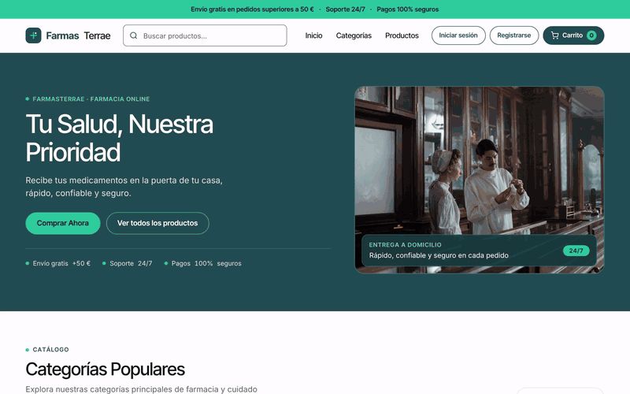
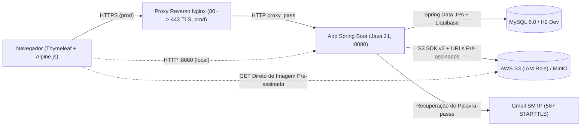

#  FarmasTerrae

Plataforma de e-commerce para farmácia online renderizada no servidor, desenvolvida com Java 21, Spring Boot 3.4, Thymeleaf, Alpine.js, MySQL 8 e armazenamento compatível com S3.

[](https://github.com/juanyaferox/FarmasTerrae/actions/workflows/maven.yml)

**Idiomas:** [English](README.md) · [Español](README.es.md) · **Português**

**Conteúdo:** [Demo](#demo) · [Design](#destaques-de-design-e-implementação) · [Funcionalidades](#funcionalidades-principais) · [Stack](#stack-tecnológica) · [Arquitetura](#arquitetura) · [Primeiros Passos](#primeiros-passos) · [Configuração](#variáveis-de-ambiente-e-perfis) · [Rotas](#controlo-de-acesso-e-rotas-principais) · [Estrutura](#estrutura-do-projeto) · [Build e CI](#compilação-logs-e-ci)

> [!NOTE]
> A interface da aplicação e as mensagens de validação encontram-se atualmente em espanhol. A documentação é mantida em inglês ([README.md](README.md)), espanhol ([README.es.md](README.es.md)) e português ([README.pt.md](README.pt.md)).

---

## Demo

[](./docs/farmasterrae-demo.mp4)

<sub>Clique na pré-visualização para abrir o vídeo em qualidade completa (MP4, 27 s).</sub>

---

## Destaques de Design e Implementação

- **Seeding com Liquibase pós-Hibernate** — `LiquibaseRunnerConfig` desativa `LiquibaseAutoConfiguration` em `prod` e `prodminio`, executando `SpringLiquibase` através de um `CommandLineRunner` *depois* de o Hibernate sincronizar o esquema para carregar dados a partir de `db/changelog/data-only-changelog.yaml`. Os dados de demonstração exigem o contexto `dev` (usado por `prodminio`); `prod` carrega apenas os perfis `ADMIN`/`USER`, e `AdminBootstrapRunner` cria o primeiro administrador a partir das variáveis `ADMIN_BOOTSTRAP_*`.

- **Pipeline de imagens no servidor e armazenamento cloud** — `ImageCompressionService` valida uploads JPEG/PNG (assinaturas mágicas, dimensões e até 10 MB), redimensiona proporcionalmente até `1200×800` por interpolação bicúbica, achata transparências sobre fundo branco RGB e codifica em JPEG a 85%. `S3StorageService` guarda os ficheiros em `product-images/` na AWS S3 (IAM instance role em `prod`) ou MinIO local e faz cache de URLs pré-assinados de curta duração com fallback para placeholder.

- **JPA Specifications reutilizáveis** — `GenericSpecification` constrói predicados Criteria `LIKE` insensíveis a maiúsculas e comparações `EQUAL` validadas por tipo em caminhos aninhados com `LEFT JOIN` automático.

- **Reserva temporária de stock no checkout** — `StockReservationService` reserva o inventário do carrinho durante 15 minutos (`stock.reservation.timeout.minutes`) para reduzir vendas sem stock durante o pagamento e deduz o stock real na confirmação da encomenda.

- **Eliminação lógica orientada à privacidade** — `UserService` preserva a integridade do histórico de encomendas na remoção de contas ao anonimizar `username` e `email`, limpar telefone e morada, registar `deletedAt`, filtrar com `@SQLRestriction("deletedAt IS NULL")` e bloquear a remoção do último administrador.

- **Auditoria global de erros correlacionados** — `GlobalExceptionHandler` combina um `Filter` de servlet com `@ControllerAdvice` para associar cada erro não tratado a um UUID `errorId` único junto com utilizador, IP do cliente (`X-Forwarded-For`), URI, método HTTP e sessão.

---

## Funcionalidades Principais

- **Loja e Catálogo** — Página inicial com produtos em destaque aleatórios, catálogo farmacêutico organizado (medicamentos, vitaminas e suplementos, cuidados pessoais, primeiros socorros, beleza e cuidados da pele, e produtos para bebés), pesquisa por palavra-chave, filtragem por categoria, paginação e ordenação por colunas.

- **Carrinho e Checkout** — Carrinho em sessão (`SessionCart`) com operações de adicionar, aumentar, diminuir, remover e limpar, validação de stock em tempo real, dados de envio pré-preenchidos, múltiplos métodos de pagamento (cartão de crédito, PayPal, transferência bancária) e acompanhamento completo de estados nas áreas de cliente e administração.

- **Autenticação e Recuperação de Conta** — Login com Spring Security 6 por nome de utilizador ou email, encriptação BCrypt, cookies `remember-me` de 7 dias, proteção contra session fixation, política de 1 sessão simultânea, recuperação de palavra-passe via Gmail SMTP e atualização autenticada com validação de complexidade.

- **Painel de Cliente (`/user/dashboard`)** — Edição de perfil, histórico paginado de encomendas com detalhe por artigo e avaliações verificadas limitadas a artigos comprados.

- **Painel de Administração (`/admin/dashboard`)** — Gestão paginada, ordenável e filtrável de produtos, encomendas e utilizadores, incluindo upload multipart de imagens e atualização de estados.

- **Armazenamento Agnóstico ao Ambiente** — Alterna entre AWS S3 (IAM role) em produção e MinIO local sem alterações de código.

---

## Stack Tecnológica

| Camada | Tecnologias |
| --- | --- |
| **Backend** | Java 21, Spring Boot 3.4.1 (Web MVC, Data JPA, Security, Validation, Mail), MapStruct 1.6.3, Lombok |
| **Frontend** | Thymeleaf, `thymeleaf-extras-springsecurity6`, Alpine.js 3, CSS modular (`tokens.css`, `components.css`, `layout.css`, `pages.css`) |
| **Base de Dados e Seed** | MySQL 8.0, Liquibase 4.32.0 (seeding pós-Hibernate), H2 2.3.232 (apenas testes e perfil local `dev`) |
| **Armazenamento** | AWS SDK para Java v2 (`s3`), MinIO (servidor local compatível com S3) |
| **Infraestrutura e DevOps** | Dockerfile multi-stage (`eclipse-temurin:21`, execução sem root), Docker Compose, proxy Nginx TLS, Logback, GitHub Actions |

---

## Arquitetura



---

## Primeiros Passos

**Pré-requisitos:** Docker e Docker Compose (Opções 1 e 2), ou JDK 21 para execução direta com Maven (Opção 3; `./mvnw` está incluído).

### Opção 1 — Ambiente Local Completo com Docker e MinIO (Recomendado)

Inicia **MySQL 8.0**, **Spring Boot** (perfil `prodminio`) e um servidor local **MinIO** compatível com S3 com criação automática do bucket `farmasterrae`.

1. Copie [`.env.example`](.env.example) para `.env` e preencha `DB_NAME`, `DB_USERNAME`, `DB_PASSWORD`, `MYSQL_ROOT_PASSWORD`, `MINIO_ROOT_USER` e `MINIO_ROOT_PASSWORD` (`EMAIL` e `PASSWORD` são opcionais exceto para testar emails de recuperação):

   ```bash
   cp .env.example .env
   ```

2. Compile e inicie os serviços:

   ```bash
   docker compose -f docker-compose.help.yml up --build
   ```

3. Aceda aos serviços (todas as portas são publicadas apenas em `127.0.0.1`):
   - **Loja** — `http://localhost:8080`
   - **Consola MinIO** — `http://localhost:9001` (`MINIO_ROOT_USER` / `MINIO_ROOT_PASSWORD`)
   - **MySQL** — `localhost:3306`

Perfis, utilizadores, produtos, encomendas e avaliações de exemplo são carregados automaticamente via Liquibase com o contexto `dev` (`src/main/resources/db/changelog/data/`). As contas de demonstração usam a palavra-passe `123`, por isso mantenha este ambiente local. O bucket é privado: as imagens são servidas através de URLs pré-assinadas. As imagens oficiais do MinIO já não são publicadas, pelo que são usadas as builds mantidas pela comunidade de [`pgsty/minio`](https://github.com/pgsty/minio).

### Opção 2 — Deploy em Produção / AWS

Inicia **MySQL 8.0**, **Spring Boot** (perfil `prod`) e **Nginx** com redirecionamento HTTP para HTTPS. Apenas o Nginx publica portas (`80` e `443`); o MySQL e a aplicação só são acessíveis na rede interna do Docker.

1. Copie [`.env.example`](.env.example) para `.env` e preencha todas as variáveis de produção (`SPRING_PROFILES_ACTIVE=prod`, `SECRET_KEY`, `DB_*`, `MYSQL_ROOT_PASSWORD`, `EMAIL`, `PASSWORD`, `AWS_REGION`, `AWS_BUCKET`), além de `ADMIN_BOOTSTRAP_USERNAME`, `ADMIN_BOOTSTRAP_EMAIL` e `ADMIN_BOOTSTRAP_PASSWORD` para o primeiro arranque (referência: [`docs/env-vars-for-prod.md`](docs/env-vars-for-prod.md)).

2. Coloque o certificado TLS e a chave privada em `./ssl/` (ignorado pelo Git e montado só de leitura; o repositório não inclui nenhum certificado):
   - `ssl/farmasterrae.crt`
   - `ssl/farmasterrae.key`

3. Defina `server_name` em [`nginx.conf`](nginx.conf) com o(s) domínio(s) do certificado (predefinição: `localhost`). Pedidos para qualquer outro nome de host são rejeitados.

4. Associe ao host uma IAM role com permissões no bucket S3 (`S3Config` usa a cadeia de credenciais predefinida da AWS em `prod`, sem chaves estáticas).

5. Inicie a stack:

   ```bash
   docker compose up --build -d
   ```

> [!IMPORTANT]
> `prod` carrega apenas os perfis `ADMIN`/`USER`, nunca as contas de demonstração. O primeiro administrador é criado com as variáveis `ADMIN_BOOTSTRAP_*` quando ainda não existe nenhum `ADMIN`; limpe-as após o primeiro arranque bem-sucedido. Use certificados emitidos por uma CA (como Let's Encrypt) antes de expor o serviço publicamente.

### Opção 3 — Modo de Desenvolvimento Local com Maven e H2

Executa o Spring Boot diretamente com base de dados H2 em memória (modo compatível com MySQL) inicializada com `src/main/resources/data.sql`. O H2 só está no classpath com o perfil Maven `dev`, que também ativa o perfil Spring `dev`.

1. Execute a aplicação:

   ```bash
   ./mvnw -Pdev spring-boot:run
   ```

   Os valores de desenvolvimento para email e S3 já vêm incluídos (`application-dev.properties`). Para usar valores reais, como um MinIO local, crie o ficheiro ignorado pelo Git `src/main/resources/application-secrets.properties`; os seus valores têm prioridade sobre os de desenvolvimento:

   ```properties
   spring.mail.username=dev@example.com
   spring.mail.password=dev-app-password
   aws.accessKey=minioadmin
   aws.secretKey=minioadmin
   aws.s3.endpoint=http://localhost:9000
   ```

2. Acessos locais:
   - **Aplicação** — `http://localhost:8080`
   - **Consola H2** — `http://localhost:8080/h2-console` (inicie sessão primeiro na aplicação como `ADMIN`, p. ex. o utilizador `juan` / `123` de `data.sql`)
     - JDBC URL: `jdbc:h2:mem:testdb;MODE=MySQL;DATABASE_TO_UPPER=false;DB_CLOSE_ON_EXIT=FALSE`
     - Utilizador: `sa` (palavra-passe vazia)

---

## Variáveis de Ambiente e Perfis

Modelo de referência: [`.env.example`](.env.example).

| Variável | Perfis | Predefinição | Descrição |
| --- | --- | --- | --- |
| `SPRING_PROFILES_ACTIVE` | `prod` | `prod` (`Dockerfile`) | Perfil Spring ativo (`prod` na AWS; fixo em `prodminio` no `docker-compose.help.yml`). |
| `SECRET_KEY` | `prod`, `prodminio` | *(obrigatória em `prod`)* | Chave secreta para assinar cookies `remember-me` de 7 dias (`app.security`). |
| `DB_NAME` | `prod`, `prodminio` | `farmasterrae` | Nome da base de dados MySQL. |
| `DB_HOST` | `prod`, `prodminio` | `localhost` / `db` | Host MySQL (`localhost` em `prod`, `db` em `prodminio` / Compose). |
| `DB_PORT` | `prod`, `prodminio` | `3306` | Porta MySQL. |
| `DB_USERNAME` | `prod`, `prodminio` | *(obrigatória)* | Utilizador MySQL. |
| `DB_PASSWORD` | `prod`, `prodminio` | *(obrigatória)* | Palavra-passe MySQL. |
| `MYSQL_ROOT_PASSWORD` | Compose | *(obrigatória)* | Palavra-passe da conta `root` do contentor MySQL (diferente de `DB_PASSWORD`; nunca usada pela aplicação). |
| `DB_SSL_MODE` | `prod`, `prodminio` | `PREFERRED` | `sslMode` do Connector/J (`REQUIRED`, `VERIFY_CA` ou `VERIFY_IDENTITY` para bases de dados geridas). |
| `HIBERNATE_DDL_AUTO` | `prod` | `update` | Modo de esquema do Hibernate; mude para `validate` quando o esquema já existir. |
| `ADMIN_BOOTSTRAP_USERNAME`, `ADMIN_BOOTSTRAP_EMAIL`, `ADMIN_BOOTSTRAP_PASSWORD` | `prod` | *(vazio)* | Criam a primeira conta `ADMIN` no arranque quando as três estão definidas e ainda não existe nenhum `ADMIN`. |
| `EMAIL` | `prod`, `prodminio` | *(vazio)* | Endereço Gmail para recuperação de palavra-passe (`spring.mail.username`). |
| `PASSWORD` | `prod`, `prodminio` | *(vazio)* | **App Password** do Gmail para autenticação SMTP (`spring.mail.password`). |
| `AWS_REGION` | `prod` | `us-east-1` | Região AWS S3 (`aws.region`). |
| `AWS_BUCKET` | `prod` | `farmasterrae` | Nome do bucket AWS S3 (`aws.s3.bucket-name`). |
| `MINIO_ROOT_USER`, `MINIO_ROOT_PASSWORD` | `prodminio` | `minioadmin` / `minioadmin` | Credenciais root do MinIO local, também usadas pela aplicação como chaves S3. |
| `AWS_PUBLIC_ENDPOINT` | `prodminio` | `http://localhost:9000` | Endereço do MinIO acessível pelo browser para os URLs pré-assinados das imagens. |

### Perfis Spring

| Perfil | Base de Dados | Armazenamento | Esquema e Dados | Utilização Prevista |
| --- | --- | --- | --- | --- |
| `dev` (`./mvnw -Pdev`) | H2 em memória (modo MySQL) | Chaves estáticas de desenvolvimento + endpoint opcional (`application-secrets.properties`) | Hibernate `update` + `data.sql` | Desenvolvimento Java rápido local |
| `prodminio` | MySQL 8.0 (`db:3306`) | MinIO (`http://minio:9000`, pré-assinado para `http://localhost:9000`) | Hibernate `update` + Liquibase (contexto `dev`: dados de demonstração) | Testes full-stack locais em Docker |
| `prod` | MySQL 8.0 | AWS S3 (IAM Instance Role) | Hibernate (`HIBERNATE_DDL_AUTO`, predefinição `update`) + Liquibase (contexto `prod`: apenas perfis) | Produção em AWS com HTTPS |

---

## Controlo de Acesso e Rotas Principais

| Nível de Acesso | Rotas | Finalidade |
| --- | --- | --- |
| **Público** | `/`, `/products`, `/products/categories`, `/products/{reference}` | Loja, diretório de categorias, pesquisa e detalhe de produto |
| **Público** | `/cart`, `/cart/add/{ref}`, `/cart/increase/{ref}`, `/cart/decrease/{ref}`, `/cart/remove/{ref}`, `/cart/clear` | Operações do carrinho em sessão |
| **Público** | `/auth`, `/auth/register`, `/auth/forgotPassword`, `/logout` | Login, registo, recuperação de palavra-passe e logout |
| **Autenticado** | `/order`, `/order/confirm`, `/auth/changePassword` | Checkout, confirmação de encomenda e alteração de palavra-passe |
| **`USER` ou `ADMIN`** | `/user/dashboard`, `/user/dashboard/info-user`, `/user/dashboard/orders`, `/user/dashboard/orders/{id}`, `/user/dashboard/reviews` | Gestão de perfil, histórico de encomendas e avaliações |
| **`ADMIN`** | `/admin/dashboard`, `/admin/dashboard/products`, `/admin/dashboard/orders`, `/admin/dashboard/users` | Gestão administrativa de catálogo, encomendas e utilizadores |

---

## Estrutura do Projeto

```text
FarmasTerrae/
├── .github/workflows/maven.yml          # CI no GitHub Actions (empacotamento Maven com JDK 21)
├── .dockerignore                        # Mantém segredos, certificados e artefactos fora da imagem
├── .env.example                         # Modelo de variáveis de ambiente
├── Dockerfile                           # Imagem multi-stage Temurin 21 com execução sem root
├── docker-compose.yml                   # Stack de produção (MySQL + App + Nginx TLS)
├── docker-compose.help.yml              # Stack local Docker (MySQL + App + MinIO)
├── docs/env-vars-for-prod.md            # Referência das variáveis de ambiente de produção
├── docs/mark.svg                        # Símbolo SVG da marca usado na documentação
├── nginx.conf                           # Proxy reverso Nginx com redirecionamento HTTP->HTTPS
├── pom.xml                              # Dependências Maven e configuração MapStruct/Lombok
├── ssl/                                 # Certificado e chave TLS montados pelo Nginx (ignorado pelo Git, fornecido no deploy)
└── src/
    ├── main/
    │   ├── java/com/iyg16260/farmasterrae/
    │   │   ├── config/                  # Security, S3, LiquibaseRunner, MVC, Web, GlobalExceptionHandler
    │   │   ├── controller/              # Controladores da loja, Auth, Cart, Order, User e Admin
    │   │   ├── dto/                     # DTOs de Auth, Order, Payment, Product e User
    │   │   ├── enums/                   # Enumerações de domínio (estados de encomenda, métodos de pagamento, operações)
    │   │   ├── mapper/                  # Mappers MapStruct (Product, Order, Review, User)
    │   │   ├── model/                   # Entidades JPA (User, Profile, Product, Order, OrderDetails, Review)
    │   │   ├── repository/              # Repositórios Spring Data JPA
    │   │   ├── service/                 # Lógica de negócio, StockReservation, ImageCompression, S3Storage
    │   │   ├── spec/                    # JPA Specifications dinâmicas (Generic, Product, Order, User)
    │   │   └── utils/                   # SessionCart, validação de palavras-passe e utilitários
    │   └── resources/
    │       ├── application*.properties  # Perfis dev, prod e prodminio
    │       ├── data.sql                 # Dados iniciais para H2 local
    │       ├── db/changelog/            # Changelog Liquibase e scripts SQL de dados
    │       ├── logback.xml              # Appenders de consola e ficheiros rotativos info/warn/error
    │       ├── static/                  # CSS modular (tokens/components/layout/pages) e ativos
    │       └── templates/               # Vistas Thymeleaf e fragmentos reutilizáveis
    └── test/                            # Testes Spring Boot
```

---

## Compilação, Logs e CI

### Comandos Maven

```bash
# Empacotar o JAR de produção (igual ao Dockerfile e CI; sem H2)
./mvnw clean package -DskipTests

# Executar testes
./mvnw test

# Executar localmente com a base de dados H2 em memória
./mvnw -Pdev spring-boot:run
```

### Logs

Configurados em `src/main/resources/logback.xml`:

- **Consola (`STDOUT`)** — Registos `INFO+` sem stack traces completos.
- **Ficheiros rotativos** em `logs/` (ignorado pelo Git):
  - `logs/info.log` — rotação diária, retenção de 30 dias
  - `logs/warn.log` — rotação diária, retenção de 30 dias
  - `logs/error.log` — rotação diária, retenção de 90 dias com stack traces completos

### Integração Contínua

Cada push ou pull request dirigido a `master` dispara [`.github/workflows/maven.yml`](.github/workflows/maven.yml), compilando e empacotando o projeto com Temurin JDK 21 e codificação UTF-8.
