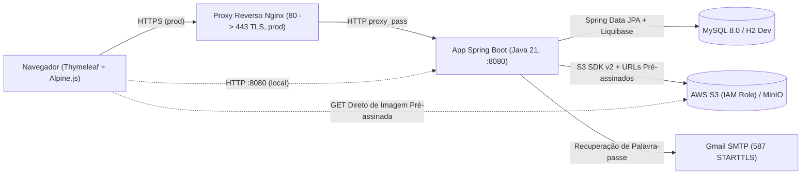

<div align="center">

# FarmasTerrae

**Plataforma de e-commerce full-stack para farmácia online desenvolvida com Java 21, Spring Boot 3, Thymeleaf, Alpine.js, MySQL e armazenamento compatível com S3.**

[](https://adoptium.net/)
[](https://spring.io/projects/spring-boot)
[](https://www.mysql.com/)
[](https://docs.docker.com/compose/)
[](https://github.com/juanyaferox/FarmasTerrae/actions/workflows/maven.yml)

**Idiomas:** [English](README.md) · [Español](README.es.md) · **Português**

</div>

---

## Visão Geral

**FarmasTerrae** é uma aplicação web de comércio eletrónico renderizada no servidor, concebida para uma farmácia online. Disponibiliza uma loja responsiva, catálogo organizado por categorias, reserva temporária de stock em sessão durante o checkout, painel de cliente para encomendas e avaliações, e um back-office administrativo completo para gerir produtos, encomendas, utilizadores e imagens.

> **Nota sobre idiomas:** A interface da aplicação e as mensagens de validação encontram-se atualmente em espanhol, enquanto a documentação do projeto está disponível em **inglês** ([README.md](README.md)), **espanhol** ([README.es.md](README.es.md)) e **português** ([README.pt.md](README.pt.md)).

## Índice

- [Funcionalidades Principais](#funcionalidades-principais)
- [Stack Tecnológica](#stack-tecnológica)
- [Arquitetura](#arquitetura)
- [Destaques de Design e Implementação](#destaques-de-design-e-implementação)
- [Primeiros Passos](#primeiros-passos)
  - [Opção 1: Ambiente Local Completo com Docker e MinIO (Recomendado)](#opção-1-ambiente-local-completo-com-docker-e-minio-recomendado)
  - [Opção 2: Deploy em Produção / AWS](#opção-2-deploy-em-produção--aws)
  - [Opção 3: Modo de Desenvolvimento Local com Maven e H2](#opção-3-modo-de-desenvolvimento-local-com-maven-e-h2)
- [Variáveis de Ambiente e Perfis](#variáveis-de-ambiente-e-perfis)
- [Controlo de Acesso e Rotas Principais](#controlo-de-acesso-e-rotas-principais)
- [Estrutura do Projeto](#estrutura-do-projeto)
- [Compilação, Logs e CI](#compilação-logs-e-ci)

---

## Funcionalidades Principais

- **Loja e Catálogo**
  - Página inicial com produtos em destaque aleatórios e atalhos para categorias.
  - Seis categorias farmacêuticas: `MEDICINE` (Medicamentos), `VITAMIN` (Vitaminas e Suplementos), `CARE` (Cuidados Pessoais), `FIRST_AID` (Primeiros Socorros), `BEAUTY` (Beleza e Cuidados da Pele) e `BABY` (Produtos para Bebés).
  - Listagem paginada com pesquisa dinâmica por palavra-chave, filtragem por categoria e ordenação com JPA Specifications.
- **Carrinho e Reserva de Stock**
  - Carrinho baseado em sessão HTTP (`SessionCart`) com suporte para adicionar, aumentar, diminuir, remover e limpar itens.
  - Serviço de reserva temporária de inventário (`StockReservationService`) durante 15 minutos (`stock.reservation.timeout.minutes`), descontando o stock real na confirmação da encomenda.
- **Checkout e Ciclo de Vida de Encomendas**
  - Resumo de compra com morada/nome pré-preenchidos e métodos de pagamento selecionáveis (`CREDIT_CARD`, `PAYPAL`, `TRANSFER`).
  - Estados de encomenda (`PENDING`, `SHIPPED`, `COMPLETED`, `CANCELLED`) acompanhados nas áreas de cliente e administração.
- **Autenticação e Recuperação de Conta**
  - Spring Security 6 com login por **nome de utilizador ou email**, encriptação BCrypt, cookies `remember-me` de 7 dias, proteção contra session fixation e política de 1 sessão simultânea.
  - Recuperação de palavra-passe via Gmail SMTP e alteração autenticada com validação de complexidade.
- **Painel de Cliente (`/user/dashboard`)**
  - Edição de perfil, histórico paginado de encomendas com detalhe por produto e avaliações restritas a artigos comprados.
- **Painel de Administração (`/admin/dashboard`)**
  - CRUD completo com pesquisa, ordenação e paginação para **Produtos**, **Encomendas** e **Utilizadores**.
  - Upload multipart de imagens de produtos com redimensionamento e compressão JPEG no servidor.
  - Eliminação de utilizadores ao estilo RGPD por anonimização (`deleted_<id>`), impedindo a remoção do último administrador.
- **Pipeline de Imagens na Cloud**
  - Integração nativa com **AWS S3** (produção via IAM instance role) e **MinIO** (desenvolvimento local em Docker), servindo imagens através de URLs pré-assinados válidos por 2 horas.

---

## Stack Tecnológica

| Camada | Tecnologias |
| --- | --- |
| **Backend** | Java 21, Spring Boot 3.4.1 (Web MVC, Data JPA, Security, Validation, Mail), MapStruct 1.6.3, Lombok |
| **Frontend** | Thymeleaf, `thymeleaf-extras-springsecurity6`, Alpine.js 3, sistema modular de CSS (`tokens.css`, `components.css`, `layout.css`, `pages.css`) |
| **Base de Dados e Seed** | MySQL 8.0, Liquibase 4.32.0 (seeding pós-Hibernate), H2 2.3.232 (perfil local `dev`) |
| **Armazenamento** | AWS SDK para Java v2 (`s3`), MinIO (servidor local compatível com S3) |
| **Infraestrutura e DevOps** | Dockerfile multi-stage (`eclipse-temurin:21`), Docker Compose, proxy reverso Nginx (TLS 1.2/1.3), logs rotativos Logback, GitHub Actions |

---

## Arquitetura



---

## Destaques de Design e Implementação

- **Seeding com Liquibase pós-Hibernate (`LiquibaseRunnerConfig`)**: A `LiquibaseAutoConfiguration` é excluída em `prod` / `prodminio` e um `CommandLineRunner` executa `SpringLiquibase` *depois* de o Hibernate criar/atualizar o esquema (`ddl-auto=update`), carregando dados iniciais de `db/changelog/data-only-changelog.yaml`.
- **Pipeline automático de imagens (`ImageCompressionService` + `S3StorageService` + `ProductMapper`)**: As imagens carregadas (até 10 MB) são redimensionadas proporcionalmente até `1200×800` com interpolação bicúbica, fundo branco RGB e compressão JPEG a 85%, guardadas no S3/MinIO e convertidas em URLs pré-assinados (TTL de 2 h) em hooks `@AfterMapping` do MapStruct.
- **Filtragem dinâmica reutilizável (`GenericSpecification`)**: Suporta pesquisas `LIKE` insensíveis a maiúsculas e comparações `EQUAL` com validação de tipo em caminhos aninhados através de `LEFT JOIN` automático.
- **Anonimização de utilizadores (`UserService`)**: Preserva a integridade do histórico de encomendas ao anonimizar `username`/`email`, limpar telefone/morada, registar `deletedAt` e filtrar com `@Where(clause = "deletedAt IS NULL")`.
- **Auditoria de erros (`GlobalExceptionHandler`)**: Combina um `Filter` de servlet com `@ControllerAdvice` para associar um UUID `errorId` único e metadados de utilizador, IP (`X-Forwarded-For`), URI, método e sessão aos logs de erro.

---

## Primeiros Passos

### Pré-requisitos

- **Docker e Docker Compose** (para a Opção 1 e Opção 2)
- **JDK 21** (apenas para a Opção 3; o Maven está incluído via `./mvnw`)

---

### Opção 1: Ambiente Local Completo com Docker e MinIO (Recomendado)

Executa **MySQL 8.0**, **Spring Boot** (perfil `prodminio`) e um servidor local **MinIO** compatível com S3 com criação automática do bucket `farmasterrae`.

1. **Crie o ficheiro `.env` a partir de [`.env.example`](.env.example):**

   ```bash
   cp .env.example .env
   ```

   Para o modo local com MinIO, as variáveis obrigatórias no `.env` são `DB_NAME`, `DB_USERNAME` e `DB_PASSWORD`. `EMAIL` e `PASSWORD` são opcionais (necessárias apenas para testar emails de recuperação).

2. **Compile e inicie os serviços:**

   ```bash
   docker compose -f docker-compose.help.yml up --build
   ```

3. **Aceda aos serviços:**
   - **Loja**: `http://localhost:8080`
   - **Consola MinIO**: `http://localhost:9001` (`minioadmin` / `minioadmin`)
   - **MySQL**: `localhost:3306`

> Perfis, utilizadores, produtos, encomendas e avaliações de exemplo são carregados automaticamente via Liquibase (`src/main/resources/db/changelog/data/`).

---

### Opção 2: Deploy em Produção / AWS

Executa **MySQL 8.0**, **Spring Boot** (perfil `prod`) e **Nginx** com redirecionamento HTTP→HTTPS (portas `80` e `443`).

1. **Configure `.env` a partir de [`.env.example`](.env.example):**

   ```bash
   cp .env.example .env
   ```

   Preencha todas as variáveis (`SPRING_PROFILES_ACTIVE=prod`, `SECRET_KEY`, `DB_*`, `EMAIL`, `PASSWORD`, `AWS_REGION`, `AWS_BUCKET`).

2. **Forneça os certificados TLS** em `./ssl/`:
   - `ssl/farmasterrae.crt`
   - `ssl/farmasterrae.key`

   > Substitua quaisquer certificados autoassinados de desenvolvimento por certificados válidos emitidos por uma CA (ex.: Let's Encrypt) antes de expor em produção.

3. **Permissões AWS S3**: Em `prod`, o `S3Config` usa `DefaultCredentialsProvider` (IAM instance role em EC2/ECS) em vez de chaves estáticas.

4. **Inicie a stack de produção:**

   ```bash
   docker compose up --build -d
   ```

---

### Opção 3: Modo de Desenvolvimento Local com Maven e H2

Executa o Spring Boot diretamente com base de dados H2 em memória (modo compatível com MySQL) preenchida com `src/main/resources/data.sql`.

1. **Crie o ficheiro ignorado pelo Git** `src/main/resources/application-secrets.properties` para resolver as propriedades de email e S3 no arranque:

   ```properties
   spring.mail.username=dev@example.com
   spring.mail.password=dev-app-password
   aws.accessKey=minioadmin
   aws.secretKey=minioadmin
   aws.region=us-east-1
   aws.s3.bucket-name=farmasterrae
   aws.s3.endpoint=http://localhost:9000
   ```

2. **Execute a aplicação:**

   ```bash
   ./mvnw spring-boot:run
   ```

3. **Acessos locais:**
   - **Aplicação**: `http://localhost:8080`
   - **Consola H2**: `http://localhost:8080/h2-console`
     - JDBC URL: `jdbc:h2:mem:testdb;MODE=MySQL;DATABASE_TO_UPPER=false;DB_CLOSE_ON_EXIT=FALSE`
     - Utilizador: `sa` (palavra-passe vazia)

---

## Variáveis de Ambiente e Perfis

Consulte [`.env.example`](.env.example) para um modelo pronto a copiar.

| Variável | Perfis | Predefinição | Descrição |
| --- | --- | --- | --- |
| `SPRING_PROFILES_ACTIVE` | `prod` | `prod` (no `Dockerfile`) | Perfil Spring ativo (`prod` na AWS; fixo em `prodminio` no `docker-compose.help.yml`). |
| `SECRET_KEY` | `prod`, `prodminio` | `uniqueAndSecret` | Chave secreta para assinar cookies `remember-me` de 7 dias (`app.security`). |
| `DB_NAME` | `prod`, `prodminio` | `farmasterrae` | Nome da base de dados MySQL. |
| `DB_HOST` | `prod`, `prodminio` | `localhost` (`prod`) / `db` (`prodminio`) | Host MySQL (`db` dentro do Docker Compose). |
| `DB_PORT` | `prod`, `prodminio` | `3306` | Porta MySQL. |
| `DB_USERNAME` | `prod`, `prodminio` | `root` | Utilizador MySQL. |
| `DB_PASSWORD` | `prod`, `prodminio` | *(vazio)* | Palavra-passe MySQL (também usada como `MYSQL_ROOT_PASSWORD` no Compose). |
| `EMAIL` | `prod`, `prodminio` | *(vazio)* | Endereço Gmail para recuperação de palavra-passe (`spring.mail.username`). |
| `PASSWORD` | `prod`, `prodminio` | *(vazio)* | **App Password** do Gmail para autenticação SMTP (`spring.mail.password`). |
| `AWS_REGION` | `prod` | `us-east-1` | Região AWS S3 (`aws.region`). |
| `AWS_BUCKET` | `prod` | `farmasterrae` | Nome do bucket AWS S3 (`aws.s3.bucket-name`). |

### Resumo de Perfis Spring

| Perfil | Base de Dados | Armazenamento | Esquema / Seed | Utilização Prevista |
| --- | --- | --- | --- | --- |
| *(predefinido / `dev`)* | H2 em memória (modo MySQL) | Chaves estáticas + endpoint opcional (`application-secrets.properties`) | Hibernate `update` + `data.sql` | Desenvolvimento Java rápido local |
| `prodminio` | MySQL 8.0 (`db:3306`) | MinIO (`http://minio:9000` → `http://localhost:9000`) | Hibernate `update` + Liquibase | Testes full-stack locais em Docker |
| `prod` | MySQL 8.0 | AWS S3 (IAM Instance Role) | Hibernate `update` + Liquibase | Produção em AWS com HTTPS |

---

## Controlo de Acesso e Rotas Principais

| Nível de Acesso | Rotas | Finalidade |
| --- | --- | --- |
| **Público** | `/`, `/products`, `/products/categories`, `/products/{reference}` | Loja, diretório de categorias, pesquisa e detalhe de produto |
| **Público** | `/cart`, `/cart/add/{ref}`, `/cart/increase/{ref}`, `/cart/decrease/{ref}`, `/cart/remove/{ref}`, `/cart/clear` | Operações do carrinho de compras em sessão |
| **Público** | `/auth`, `/auth/register`, `/auth/forgotPassword`, `/logout` | Login, registo, recuperação de palavra-passe e logout |
| **Autenticado** | `/order`, `/order/confirm`, `/auth/changePassword` | Checkout, confirmação de encomenda e alteração de palavra-passe |
| **`USER` ou `ADMIN`** | `/user/dashboard`, `/user/dashboard/info-user`, `/user/dashboard/orders`, `/user/dashboard/orders/{id}`, `/user/dashboard/reviews` | Gestão de perfil, histórico de encomendas e avaliações |
| **`ADMIN`** | `/admin/dashboard`, `/admin/dashboard/products`, `/admin/dashboard/orders`, `/admin/dashboard/users` | Gestão administrativa de catálogo, encomendas e utilizadores |

---

## Estrutura do Projeto

```text
FarmasTerrae/
├── .github/workflows/maven.yml          # CI no GitHub Actions (empacotamento Maven com JDK 21)
├── .env.example                         # Modelo de variáveis de ambiente
├── Dockerfile                           # Imagem multi-stage de compilação e execução Temurin 21
├── docker-compose.yml                   # Stack de produção (MySQL + App + Nginx TLS)
├── docker-compose.help.yml              # Stack local Docker (MySQL + App + MinIO)
├── nginx.conf                           # Proxy reverso Nginx com redirecionamento HTTP->HTTPS
├── pom.xml                              # Dependências Maven e configuração MapStruct/Lombok
├── ssl/                                 # Certificado e chave TLS montados pelo Nginx
└── src/
    ├── main/
    │   ├── java/com/iyg16260/farmasterrae/
    │   │   ├── config/                  # Security, S3, LiquibaseRunner, MVC, Web, GlobalExceptionHandler
    │   │   ├── controller/              # Controladores da loja, Auth, Cart, Order, User e Admin
    │   │   ├── dto/                     # DTOs de Auth, Order, Payment, Product e User
    │   │   ├── enums/                   # Category, PaymentMethod, SaleStatus, EntityType, Operation
    │   │   ├── mapper/                  # Mappers MapStruct (Product, Order, Review, User)
    │   │   ├── model/                   # Entidades JPA (User, Profile, Product, Order, OrderDetails, Review)
    │   │   ├── repository/              # Repositórios Spring Data JPA
    │   │   ├── service/                 # Lógica de negócio, StockReservation, ImageCompression, S3Storage
    │   │   ├── spec/                    # JPA Specifications dinâmicas (Generic, Product, Order, User)
    │   │   └── utils/                   # SessionCart, validação de palavras-passe e utilitários
    │   └── resources/
    │       ├── application*.properties  # Perfis dev, prod e prodminio
    │       ├── data.sql                 # Dados iniciais para H2 local
    │       ├── db/changelog/            # Changelog Liquibase e scripts SQL de dados
    │       ├── logback.xml              # Appenders de consola e ficheiros rotativos info/warn/error
    │       ├── static/                  # CSS modular (tokens/components/layout/pages) e ativos
    │       └── templates/               # Vistas Thymeleaf e fragmentos reutilizáveis
    └── test/                            # Testes Spring Boot
```

---

## Compilação, Logs e CI

### Comandos Maven

```bash
# Empacotar o JAR (igual ao Dockerfile e CI)
./mvnw clean package -DskipTests

# Executar testes
./mvnw test
```

### Logs

Configurados em `src/main/resources/logback.xml`:

- **Consola (`STDOUT`)**: Mensagens `INFO+` sem stack traces completos.
- **Ficheiros rotativos** em `logs/` (ignorado pelo Git):
  - `logs/info.log` — rotação diária, retenção de 30 dias
  - `logs/warn.log` — rotação diária, retenção de 30 dias
  - `logs/error.log` — rotação diária, retenção de 90 dias com stack traces completos

### Integração Contínua

Cada push ou pull request dirigido a `master` dispara [`.github/workflows/maven.yml`](.github/workflows/maven.yml), compilando e empacotando o projeto com Temurin JDK 21 e codificação UTF-8.
